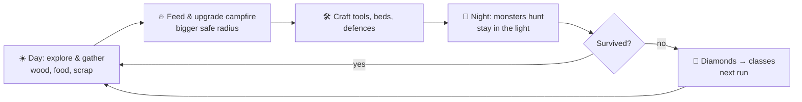

# 🔦 99 Nights in the Forest

![[99-nights_icon.png|180]]

> [!summary] TL;DR — co-op survival horror with a campfire at its heart
> ✅ The whole store description is three lines: "Build a camp with friends. / Something is watching you. / 99 Nights in the Forest." Survive night after night in a dark, 📰 procedurally generated forest; keep the **campfire** alive, gather, craft, rescue lost kids, and survive monsters (📰 the Deer, Owl, Cultists). Created 2025-03-04; 📰 PC Gamer reported a **14.2M peak**; today **#8** with 115,838 players and 30.50B visits.

> [!note] Confidence legend
> ✅ official Roblox data · 📰 third-party guides · 🔎 official store images · 🧠 design analysis — verify in-game

> [!info] ✅ Live snapshot — Roblox API, 2026-11-12
> | Metric | Value |
> |---|---|
> | Players right now | **115,838** (#8 Top Playing Now) |
> | Top Trending rank | — |
> | Total visits | 30,502,148,353 (30.50B) |
> | Favorites | 10,253,050 |
> | Like ratio | 90.5% |
> | Server size (max players) | 25 |
> | Created | 2025-03-04 |
> | Last updated | 2026-11-12 |
> | Genre (Roblox taxonomy) | Survival › — |
> | Developer | Grandma's Favourite Games (Group) |
> | Game passes for sale | 1 |
> | Store page | [roblox.com/games/79546208627805](https://www.roblox.com/games/79546208627805) |

## 1. Core loop

## 2. Gameplay mechanics

- 📰 **Goal: reach Day 99.** A visible counter that only goes up — every night survived is progress.
- 📰 **The campfire** is the base, the light, and the safe zone; upgrading it pushes back fog and danger.
- 📰 **Classes** bought with Diamonds give perks/tools (✅ the retired "Ranger Class" and "Medic Class" passes show classes were once sold for Robux; today one Decorator Pass is on sale).
- 📰 **Rescue missions** (lost kids) give co-op objectives beyond survival.
- ✅ 25-player servers for co-op camps.

## 3. HUD

![[hud-99-nights.jpg]]

| # | Element | Notes | Conf. |
|--:|---|---|:--:|
| 1 | **DAY counter + day/night phase** | The title promise ('99 nights') as the main HUD element. | 📰/🧠 |
| 2 | **Health + hunger** | Bottom-left above the hotbar. | 🧠 |
| 3 | **Campfire level + fuel** (world-space) | The team's shared health bar. | 📰/🧠 |
| 4 | **Tools hotbar + sack capacity** | Axe, flashlight, food, sack. | 🧠 |
| 5 | **Objectives panel** | Rescue / upgrade / explore. | 📰/🧠 |
| 6 | **Class chip** | Shows your role in the team. | 📰 |
| 7 | **Darkness as HUD** | Fog and vignette *are* the threat indicator. | 🧠 |

## 4. Art style

> [!gallery]- 🔎 Official store images (3) — click to expand
> ![[99-nights_thumb-1.jpg]] ![[99-nights_thumb-2.jpg]] ![[99-nights_thumb-3.jpg]]

- 🔎 **Mostly black** (`#0B0C08` = 27% of store pixels) with **warm firelight**. 🧠 Horror on Roblox works best when the art budget goes to *light*, not detail.
- 🔎 **The Deer**: a simple, memeable monster — antlers, huge white cartoon eyes, open mouth. 🧠 Readable silhouette + funny-scary face = fan art and TikToks.

🎨 **Measured palette** (store images, share of pixels):  `#0B0C08` 27.0%  `#341D15` 12.5%  `#021C33` 10.0%  `#5F372C` 7.4%  `#1A6506` 5.1%  `#093959` 4.3%  `#A85A4E` 3.8%

## 5. Shop, game passes & monetization

| Icon | Pass | Price | What it gives (official description) |
|:--:|---|--:|---|
| ![[99-nights_pass-1637362713.png\|56]] | **Decorator Pass** | R$ 199 | Gain perks to help you decorate your base! - Get a hammer + paintbrush from the supply crate - Purchase from the furniture trader remotely - Discounts on the… |

_Plus 3 retired / off-sale passes (limited-time items, old bundles) — see [[Game Pass Database]]._

- ✅ Only one pass on sale (Decorator Pass 199); class and hunter passes were retired. 🧠 The game moved monetization to Diamonds (soft/hard currency) — a common shift once a game outgrows one-off passes.

## 6. Why it performs

1. **Co-op fear** — scary is better with friends (and streams well).
2. **A goal in the title** — "99 Nights" is the progress bar.
3. **Campfire = shared base** everyone protects.
4. **Mystery-first marketing** (3-line description, monster-face icon).

## 7. Steal this

> [!tip] Copy these
> - Put the **win condition in the name**.
> - Give the team **one shared object** to protect.
> - Spend art budget on **lighting and silhouettes**.

## Sources
- ✅ Roblox API 2026-11-12 · 📰 [PC Gamer — 14.2M peak](https://www.pcgamer.com/games/survival-crafting/with-a-peak-player-count-of-14-2-million-99-nights-in-the-forest-has-an-audience-other-multiplayer-games-would-kill-for-to-find-these-behemoth-playerbases-you-need-to-be-on-a-platform-like-roblox/) · [PC Gamer — classes](https://www.pcgamer.com/roblox/99-nights-in-the-forest-classes) · [PC Gamer — survival tips](https://www.pcgamer.com/games/roblox/99-nights-in-the-forest-tips)
