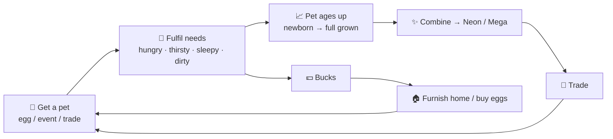

# 🐶 Adopt Me!

![[adopt-me_icon.png|180]]

> [!summary] TL;DR — pet care + trading + family roleplay
> Adopt and raise pets (and babies), complete their **needs** to earn Bucks and age them up, build your dream home, and **trade** for legendary pets. Uplift Games, created 2017-07-14; **#6** today (159,514 players). ✅ The current description sells a "⚡ Lightning Dimension" event — catch lightning in a bottle, trade for lure baits, lure the Legendary Haetyphoon — and asks players to press **🔔 NOTIFY** to be first for updates.

> [!note] Confidence legend
> ✅ official Roblox data · 📰 third-party guides · 🔎 official store images · 🧠 design analysis — verify in-game

> [!info] ✅ Live snapshot — Roblox API, 2026-11-12
> | Metric | Value |
> |---|---|
> | Players right now | **159,514** (#6 Top Playing Now) |
> | Top Trending rank | — |
> | Total visits | 45,395,688,106 (45.40B) |
> | Favorites | 29,866,259 |
> | Like ratio | 86.4% |
> | Server size (max players) | 35 |
> | Created | 2017-07-14 |
> | Last updated | 2026-11-11 |
> | Genre (Roblox taxonomy) | Roleplay & Avatar Sim › Pet Care |
> | Developer | Uplift Games (Group) |
> | Game passes for sale | 5 |
> | Store page | [roblox.com/games/920587237](https://www.roblox.com/games/920587237) |

## 1. Core loop

## 2. Gameplay mechanics

- 🧠 **Needs as quests**: each need bubble is a tiny task with a timer and a Bucks reward — the game generates its own to-do list.
- 🧠 **Aging + combining** (neon/mega) turns duplicate pets into progress, keeping the trading economy liquid.
- ✅ **Event lures** (the current event: lure baits traded between players, a legendary to lure).
- ✅ Pet pens are monetized (+1 Pet Pen Slot pass).

## 3. HUD

![[hud-adopt-me.jpg]]

| # | Element | Notes | Conf. |
|--:|---|---|:--:|
| 1 | **Bucks counter** | One soft currency, top-left. | 🧠 |
| 2 | **Needs bubbles** with progress rings + rewards | The game's quest log, right edge. | 🧠 |
| 3 | **Labelled pill buttons** (Backpack, Dress Up, Trade, Shop, Family) | Icon + word — friendly for young readers. | 🧠 |
| 4 | **Pet-need toast** | Directs attention to the next task. | 🧠 |
| 5 | **Age-up progress** | Long-term goal always visible. | 🧠 |

## 4. Art style

> [!gallery]- 🔎 Official store images (6) — click to expand
> ![[adopt-me_thumb-1.jpg]] ![[adopt-me_thumb-2.jpg]] ![[adopt-me_thumb-3.jpg]] ![[adopt-me_thumb-4.jpg]] ![[adopt-me_thumb-5.jpg]] ![[adopt-me_thumb-6.jpg]]

- 🔎 **Soft, rounded 'vinyl toy' 3D** — big glossy eyes, pastel-saturated colours, cartoon low-poly trees and cottages. 🧠 Pets are designed to be *loved*, not to look powerful.
- 🔎 Same bottom-left 'ADOPT ME!' logo lockup across every store image (series template).

🎨 **Measured palette** (store images, share of pixels):  `#F4F6F0` 10.8%  `#2C3037` 10.2%  `#FACA37` 9.9%  `#7EE8F4` 8.8%  `#4ED31B` 8.3%  `#84857C` 8.3%  `#F6D882` 7.8%

## 5. Shop, game passes & monetization

| Icon | Pass | Price | What it gives (official description) |
|:--:|---|--:|---|
| ![[adopt-me_pass-5300198.png\|56]] | **Premium Plots** | R$ 285 | Move your home to any glowing space near the Nursery |
| ![[adopt-me_pass-1585546290.png\|56]] | **+1 Pet Pen Slot** | R$ 295 | Unlocks an additional Pet Pen Slot! |
| ![[adopt-me_pass-3196348.png\|56]] | **VIP** | R$ 480 | VIP Benefits: + VIP Room Access + Exclusive Limo + Exclusive House + Golden Bone + VIP Chat Tag + 100 Adopt Me Cash |
| ![[adopt-me_pass-189425850.png\|56]] | **Cozy Home Lure** | R$ 765 | — |
| ![[adopt-me_pass-6040696.png\|56]] | **Millionaire Pack** | R$ 795 | + Millionaire Mansion + Luxury Car |

_Plus 19 retired / off-sale passes (limited-time items, old bundles) — see [[Game Pass Database]]._

- ✅ Retired **Starter Pack: "Only 99 R$! (items worth 560 R$)"** — 🧠 the anchored-value starter pack is a textbook first-purchase converter.
- ✅ Homes, vehicles, lures, VIP — status and comfort, not power.

## 6. Why it performs

1. **Nurturing fantasy** with collectible pets.
2. **Trading economy** with rarity + neon tiers.
3. **Weekly updates/events** and the Notify habit.
4. **Family roleplay** for younger players.

## 7. Steal this

> [!tip] Copy these
> - Turn care tasks into **timed need bubbles** with rewards.
> - Make **duplicates useful** (combine/upgrade).
> - Use Roblox's **Notify** button in your description.

## Sources
- ✅ Roblox API 2026-11-12. Full list: [[Sources]]
