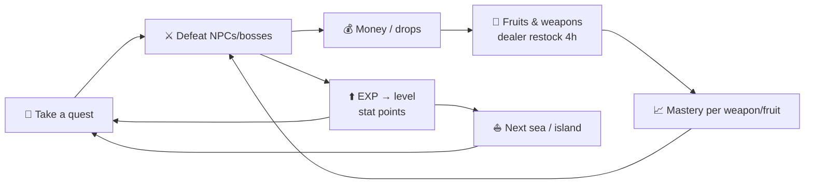

# 🍎 Blox Fruits

![[blox-fruits_icon.png|180]]

> [!summary] TL;DR — the long-haul action RPG
> An anime-inspired pirate RPG: level up (✅ **level cap 3000**), choose a fighting identity (sword, gun, melee, or a **Devil-Fruit-style power** — ✅ ~42 fruits listed in the description), sail between seas, fight bosses and players. **Timers create appointments**: ✅ fruits spawn on the map every hour and despawn after 20 minutes; the dealer restocks every 4 hours. Created 2019-01-16, still **#3** (335,144 players) with **92.3%** likes.

> [!note] Confidence legend
> ✅ official Roblox data · 📰 third-party guides · 🔎 official store images · 🧠 design analysis — verify in-game

> [!info] ✅ Live snapshot — Roblox API, 2026-11-12
> | Metric | Value |
> |---|---|
> | Players right now | **335,144** (#3 Top Playing Now) |
> | Top Trending rank | — |
> | Total visits | 65,446,282,638 (65.45B) |
> | Favorites | 20,225,637 |
> | Like ratio | 92.3% |
> | Server size (max players) | 12 |
> | Created | 2019-01-16 |
> | Last updated | 2026-11-11 |
> | Genre (Roblox taxonomy) | RPG › Action RPG |
> | Developer | Gamer Robot Inc (Group) |
> | Game passes for sale | 6 |
> | Store page | [roblox.com/games/2753915549](https://www.roblox.com/games/2753915549) |

## 1. Core loop

## 2. Gameplay mechanics

- ✅ **Fruits spawn every hour, despawn after 20 min** — server-wide treasure hunts.
- ✅ **Fruit dealer restocks random fruits every 4 hours** — a rotating shop = daily login reason.
- ✅ **Mastery** per item (2x Mastery pass) — depth beyond level.
- ✅ **Boss drops** (2x Boss Drops pass) and sea travel (Fast Boats pass).
- 🧠 Four combat styles × dozens of fruits = build variety and PvP meta debates (YouTube fuel).

## 3. HUD

![[hud-blox-fruits.jpg]]

| # | Element | Notes | Conf. |
|--:|---|---|:--:|
| 1 | **HP + Energy bars**, bottom-center | Classic action-RPG pairing. | 🧠 |
| 2 | **Level · money · fragments** | Progress numbers sit beside the bars. | 🧠 |
| 3 | **Hotbar: melee / fruit / sword / gun** | One slot per combat style. | 🧠 |
| 4 | **Skill buttons Z X C V F** with cooldown sweeps | Moves are the content; cooldown visuals teach timing. | 🧠 |
| 5 | **Left menu** (stats, items, crew) | Dark plates with gold trim = pirate theme in the UI itself. | 🧠 |
| 6 | **Quest tracker**, top | Always shows the current objective + reward. | 🧠 |
| 7 | **Fruit spawn notifier** | ✅ sold as a R$ 2,700 pass: "Alerts you when a fruit spawns… and displays how far away you are." | ✅ |

## 4. Art style

> [!gallery]- 🔎 Official store images (10) — click to expand
> ![[blox-fruits_thumb-1.jpg]] ![[blox-fruits_thumb-2.jpg]] ![[blox-fruits_thumb-3.jpg]] ![[blox-fruits_thumb-4.jpg]] ![[blox-fruits_thumb-5.jpg]] ![[blox-fruits_thumb-6.jpg]] ![[blox-fruits_thumb-7.jpg]] ![[blox-fruits_thumb-8.jpg]] ![[blox-fruits_thumb-9.jpg]] ![[blox-fruits_thumb-10.jpg]]

- 🔎 **Painted anime key art** for every store image (dramatic lighting, fire/lightning VFX, logo with a fruit-shaped 'O'). 🧠 Illustrated thumbnails signal 'epic adventure' and stand out in a feed of 3D renders.
- 🧠 In-game: stylised low-poly islands; the VFX of fruit powers carry the spectacle.

🎨 **Measured palette** (store images, share of pixels):  `#1A1318` 17.1%  `#202D4C` 10.5%  `#5A2C26` 10.3%  `#E17C2F` 8.5%  `#395B7F` 7.6%  `#885C4C` 7.4%  `#F6C228` 5.8%

## 5. Map & world

- 🧠 **Archipelago across multiple seas** — each island is a level band with a theme, bosses and quests. Sailing between them is downtime that makes arrival feel earned (and sells boats).

## 6. Shop, game passes & monetization

| Icon | Pass | Price | What it gives (official description) |
|:--:|---|--:|---|
| ![[blox-fruits_pass-6525589.png\|56]] | **Fast Boats** | R$ 350 | Unlock access to the Luxury Boat Dealer! You can choose between the FREE Miracle boat, or the massive Sentinel. |
| ![[blox-fruits_pass-7578721.png\|56]] | **2x Boss Drops** | R$ 350 | Bosses will drop special items twice as often! |
| ![[blox-fruits_pass-6240746.png\|56]] | **2x Mastery** | R$ 450 | Gain mastery twice as fast! You gain mastery by finishing off enemies with the item you want to level up. |
| ![[blox-fruits_pass-6028662.png\|56]] | **2x Money** | R$ 450 | Get 2x money for quest and kill rewards! |
| ![[blox-fruits_pass-6028786.png\|56]] | **Dark Blade** | R$ 1,200 | Unlocks Mythical sword Dark Blade. Check your item inventory to equip it! |
| ![[blox-fruits_pass-6738811.png\|56]] | **Fruit Notifier** | R$ 2,700 | Alerts you when a fruit spawns in your server and displays how far away you are from it. |

- ✅ **Fruit Notifier at R$ 2,700** monetizes the scarcity timer itself — information is the product.
- ✅ Classic 2x passes (money, mastery, boss drops) + one mythical weapon (Dark Blade 1,200).
- 🧠 Fruits are also sold as developer products / permanent fruits — the highest-value purchases are the content itself.

## 7. Why it performs

1. **Power fantasy from a beloved anime genre.**
2. **Very long progression** (level 3000) + mastery + builds.
3. **Server-wide timed events** (fruit spawns, restocks).
4. **PvP & trading** create a meta and an economy.
5. **Years of content** — six+ years of updates.

## 8. Steal this

> [!tip] Copy these
> - Put **scarce, timed spawns** on the shared map so every server has a treasure hunt.
> - Sell **information** (notifiers, radar) next to power.
> - Make the UI chrome match the theme (gold-trim pirate plates).

## Sources
- ✅ Roblox API 2026-11-12. Full list: [[Sources]]
