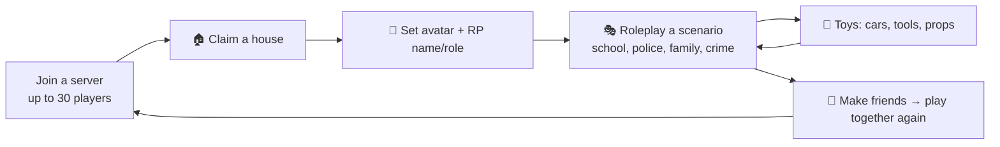

# 🏡 Brookhaven RP

![[brookhaven_icon.png|180]]

> [!summary] TL;DR — the world *is* the game
> No goals, no levels, no currency grind: a believable suburban town where you claim a house, drive cars and roleplay any life you want with friends. **89.44B visits** — the most-visited game in this vault — and still **#2 on Top Playing Now** (374,701) six years after launch (2020-04-21). Monetization sells **expression and toys**, not power. ✅ Current description advertises an Art Deco house update and an **official Coach outfit + handbag** in the avatar editor — brand partnerships are now part of the content calendar.

> [!note] Confidence legend
> ✅ official Roblox data · 📰 third-party guides · 🔎 official store images · 🧠 design analysis — verify in-game

> [!info] ✅ Live snapshot — Roblox API, 2026-11-12
> | Metric | Value |
> |---|---|
> | Players right now | **374,701** (#2 Top Playing Now) |
> | Top Trending rank | — |
> | Total visits | 89,443,850,325 (89.44B) |
> | Favorites | 30,969,180 |
> | Like ratio | 85.9% |
> | Server size (max players) | 30 |
> | Created | 2020-04-21 |
> | Last updated | 2026-11-11 |
> | Genre (Roblox taxonomy) | Roleplay & Avatar Sim › Life |
> | Developer | Brookhaven by Voldex (Group) |
> | Game passes for sale | 18 |
> | Store page | [roblox.com/games/4924922222](https://www.roblox.com/games/4924922222) |

## 1. Core loop

The loop is **social, not numerical**: the 'reward' is a good story with other people. ✅ Private-server perks (save props, admin tools, change time/weather/lighting, music, spawn 3 vehicles) turn it into a free-form stage for friend groups.

## 2. Gameplay mechanics

- ✅ Own houses (free + premium + estate lots), drive cars, roleplay jobs (student, parent, police…), explore landmarks (Brookhaven School, Jett's).
- ✅ Toys as passes: disasters you can trigger in your home (fire, flood, zombies, aliens), map-wide themes (Futuristic City, War Zone…), boombox music, horses, boats, pets.
- 🧠 **Zero failure states** — nothing to lose means nothing to fear; ideal for younger and social-first players.

## 3. HUD

![[hud-brookhaven.jpg]]

| # | Element | Notes | Conf. |
|--:|---|---|:--:|
| 1 | **Left icon rail** (avatar, house, vehicles, tools, settings) | Round white icon buttons, minimal text. | 🧠 |
| 2 | **Contextual panel** (e.g. Vehicles) | Free items first; premium items visibly locked with a ⭐ ribbon — the shop lives *inside* the content menus. | 🧠 |
| 3 | **'Claim House' prompt** | One-tap ownership. | 🧠 |
| 4 | **RP name / bio billboard** | Identity is the game. | 🧠 |
| 5 | **Empty center** | No persistent HUD — immersion. | 🧠 |

→ [[HUD Design#Archetype C — social / roleplay]]

## 4. Art style

> [!gallery]- 🔎 Official store images (9) — click to expand
> ![[brookhaven_thumb-1.jpg]] ![[brookhaven_thumb-2.jpg]] ![[brookhaven_thumb-3.jpg]] ![[brookhaven_thumb-4.jpg]] ![[brookhaven_thumb-5.jpg]] ![[brookhaven_thumb-6.jpg]] ![[brookhaven_thumb-7.jpg]] ![[brookhaven_thumb-8.jpg]] ![[brookhaven_thumb-9.jpg]]

- 🔎 **Clean, semi-realistic suburb** with modern architecture — the most desaturated palette of the top games (greys `#D6D6D5`, `#B9B8B8`). 🧠 A neutral world lets avatars, cars and props carry the colour.
- 🔎 **Thumbnail series template**: same white window frame + red ribbon logo; only the 'life scene' inside changes. ![[anno-thumbnail-series.jpg]]

🎨 **Measured palette** (store images, share of pixels):  `#D6D6D5` 24.3%  `#B9B8B8` 14.3%  `#8B8E93` 9.6%  `#67615E` 9.4%  `#B98A71` 7.6%  `#24201F` 6.7%  `#FAFAFA` 4.8%

## 5. Map & world

- 🧠 A **dense, walkable town** with recognisable landmarks (school, hospital, shops, police, prison landmark ✅ pass), roads for cars, and claimable lots. Landmarks = roleplay prompts ("meet at Jett's").
- ✅ Premium land is a product: estates, penthouse, lake houses (Land Unlocked, Estates Unlocked, Penthouse passes).

## 6. Shop, game passes & monetization

| Icon | Pass | Price | What it gives (official description) |
|:--:|---|--:|---|
| ![[brookhaven_pass-9066924.png\|56]] | **Vehicle Upgrade** | R$ 35 | Increase speed to 100 mph for street vehicles and 40 mph for small vehicles. |
| ![[brookhaven_pass-10991517.png\|56]] | **On Demand Fire** | R$ 40 | Trigger a house fire anytime for dramatic or chaotic roleplay. |
| ![[brookhaven_pass-10991687.png\|56]] | **Horse Upgrade** | R$ 85 | Unlock 6+ new horse breeds, from small to large, and customize their body, mane, tail, and saddle. Includes unique textures and boosts top speed to 50 mph. |
| ![[brookhaven_pass-19660651.png\|56]] | **Penthouse** | R$ 180 | Unlock the rooftop penthouse lot with 3+ luxury apartment layouts and the best view in Brookhaven. |
| ![[brookhaven_pass-9066970.png\|56]] | **Vehicle Speed Unlocked** | R$ 199 | Boost street vehicles up to 200 mph and small vehicles up to 50 mph. Also unlock Turbo Chargers at Stages 1, 2, and 3 for faster acceleration in supported vehicles. |
| ![[brookhaven_pass-9066988.png\|56]] | **Music Unlocked** | R$ 199 | Unlock 300+ songs to play in your house, car, or anywhere using the Boombox tool. Share your music with players nearby. |
| ![[brookhaven_pass-1899013193.png\|56]] | **Vehicle Boost Upgrade** | R$ 199 | Unlock a speed boost for your vehicles that take you past max speeds! This includes flame effects on your vehicle. The colors can be changed with the Vehicle… |
| ![[brookhaven_pass-1459820822.png\|56]] | **Vehicle Customization** | R$ 299 | Customize your ride! Change your vehicle color and style with 30 Wraps, 7+ underglow options, and add fire, smoke and wheel loss for enhanced roleplay! |
| ![[brookhaven_pass-667983868.png\|56]] | **Boat Pack** | R$ 299 | Unlock exclusive vehicles like speedboats, ships, yachts, rafts, and even sharks for water-based roleplay. |
| ![[brookhaven_pass-25341106.png\|56]] | **Theme Pack** | R$ 299 | Unlock 10+ map-wide themes like Futuristic City, War Zone, Horse Trails, City on Fire, and more. Everyone in your Private Server sees the change. |
| ![[brookhaven_pass-9066980.png\|56]] | **Premium** | R$ 320 | Gain access to Premium houses, exclusive vehicles, the helicopter, jet plane, and house pools. Your username also gets a unique color in chat. |
| ![[brookhaven_pass-13405328.png\|56]] | **Land Unlocked** | R$ 375 | Unlock 5+ rare house locations with amazing views and distinct vibes. Includes Lake House, Eagle View, Gold Ranch, Lake Side, Hidden Valley, Paradise Island, Beach… |
| ![[brookhaven_pass-48857519.png\|56]] | **Disaster Pass** | R$ 375 | Unlock 10+ disasters like fire, flood, zombies, ghosts, aliens, and more. Activate them in your home or apartment to add drama to any roleplay. |
| ![[brookhaven_pass-82773869.png\|56]] | **Estates Unlocked** | R$ 599 | Unlock 10+ massive estate houses on premium North, South, and Island lots. These plots support large-scale builds like mansions, hotels, parks, and military bases. |
| ![[brookhaven_pass-15927395.png\|56]] | **Vehicle Pack** | R$ 599 | Unlock 20+ stylish vehicles across all categories, including sports cars, themed trucks, and roleplay favorites. |
| ![[brookhaven_pass-1924902263.png\|56]] | **House Pets** | R$ 599 | Your own personal Pet! Unlock additional unique pets: Shiba Inu, German Shepherd, Dachshund, Bengal Cat, Turtle, and Bunny! And more coming soon! |
| ![[brookhaven_pass-1904016251.png\|56]] | **Prison Landmark** | R$ 699 | Unlocks: + Prison Landmark + Unique Tear Gas Launcher + Custom Warden Pistol + High Security Prisoner Bus vehicle Roleplay with others as inmates, guard officers, and… |
| ![[brookhaven_pass-850049439.png\|56]] | **VIP** | R$ 749 | Unlock 100+ exclusive items including VIP houses, vehicles, tools, props, animations and avatar effects. Gain a VIP chat tag, rainbow name color, job badge, and… |

_Plus 6 retired / off-sale passes (limited-time items, old bundles) — see [[Game Pass Database]]._

- ✅ **18 passes from R$ 35 to R$ 749**: micro-toys at 35–85 (Vehicle Upgrade 35, On Demand Fire 40, Horse Upgrade 85), core packs at 299–599, VIP at 749.
- 🧠 **Sell verbs, not stats**: "trigger a fire", "drive 200 mph", "play 300+ songs", "own a penthouse". Every pass creates a new roleplay situation.
- ✅ Brand collab content (Coach) in the avatar editor.

## 7. Why it performs

1. **Infinite content generated by players** (stories), cheap to maintain.
2. **Friend-group stickiness** — the game is where friends meet.
3. **No skill floor** — anyone can play on any device.
4. **Toy passes at every price** (35 → 749).
5. **Steady 'house/vehicle drop' updates** + brand partnerships.

## 8. Steal this

> [!tip] Copy these
> - If there's no progression, monetize **verbs and spaces** (things to do, places to own).
> - Put locked premium items **inside** the normal menus next to free ones.
> - Keep the HUD to an icon rail and let the world carry the screen.

## Sources
- ✅ Roblox API 2026-11-12. Full list: [[Sources]]
