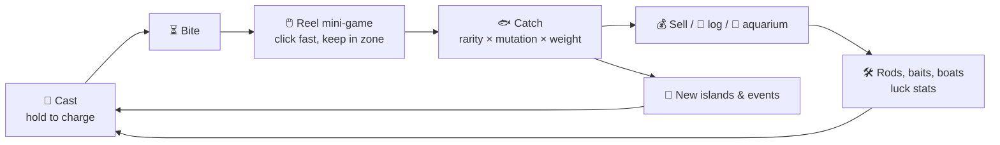

# 🐟 Fish It!

![[fish-it_icon.png|180]]

> [!summary] TL;DR — a fishing collectathon built on a luck economy
> ✅ "Click to charge up · Click as fast as you can!" — cast with a charge meter, reel with a clicking mini-game, and collect from ✅ "1,000,000+ variations" of fish (species × rarity × mutation × weight). ✅ The description openly says "Inspired by Fisch and Fishing Simulator" — it iterated on a proven genre. Created 2024-10-21; **#14** today (65,483 players). Its passes are a **luck ladder**: +30% → +80% → +150%.

> [!note] Confidence legend
> ✅ official Roblox data · 📰 third-party guides · 🔎 official store images · 🧠 design analysis — verify in-game

> [!info] ✅ Live snapshot — Roblox API, 2026-11-12
> | Metric | Value |
> |---|---|
> | Players right now | **65,483** (#14 Top Playing Now) |
> | Top Trending rank | — |
> | Total visits | 4,825,056,946 (4.83B) |
> | Favorites | 1,289,019 |
> | Like ratio | 82.8% |
> | Server size (max players) | 20 |
> | Created | 2024-10-21 |
> | Last updated | 2026-11-12 |
> | Genre (Roblox taxonomy) | Simulation › Incremental Simulator |
> | Developer | Fish Atelier (Group) |
> | Game passes for sale | 12 |
> | Store page | [roblox.com/games/121864768012064](https://www.roblox.com/games/121864768012064) |

## 1. Core loop

## 2. Gameplay mechanics

- ✅ **Two-step skill check**: charge (timing) then reel (speed). 📰 Release the cast in the strong 'luck' zone of the meter.
- 📰 **Rarity tiers** up to *Secret* and *Forgotten* (one guide lists Forgotten at ~1 in 25M; secret fish at 1 in 750K–2.5M).
- ✅ **Mutations** (More Mutations pass: +60% chance) and **luck** (three luck passes).
- ✅ Social features in the current update: **fishing crews, group fishing events, cutscene finishers, aquarium customization, limited battlepass and gacha**.
- ✅ **Sell Anywhere** pass removes the walk to the merchant — 🧠 convenience passes monetize deliberate friction.

## 3. HUD

![[hud-fish-it.jpg]]

| # | Element | Notes | Conf. |
|--:|---|---|:--:|
| 1 | **Cast charge meter** with gold zone | Timing skill + luck. | ✅/📰 |
| 2 | **Reel bar** — keep the fish in the green window, progress below | "Click as fast as you can!" | ✅ |
| 3 | **Catch card** — name, rarity, odds, weight, mutation, value | The dopamine moment; screenshot-able. | 📰/🧠 |
| 4 | **Bag · Shop · Quests · Boats** | Left 2×2 grid. | 🧠 |
| 5 | **Active boosts** row (luck %, mutation %, event) | Shows the value of passes while you play. | ✅/🧠 |
| 6 | **Coins** | One currency. | 🧠 |

## 4. Art style

> [!gallery]- 🔎 Official store images (9) — click to expand
> ![[fish-it_thumb-1.jpg]] ![[fish-it_thumb-2.jpg]] ![[fish-it_thumb-3.jpg]] ![[fish-it_thumb-4.jpg]] ![[fish-it_thumb-5.jpg]] ![[fish-it_thumb-6.jpg]] ![[fish-it_thumb-7.jpg]] ![[fish-it_thumb-8.jpg]] ![[fish-it_thumb-9.jpg]]

- 🔎 **One template, nine thumbnails**: same dock, same straining avatar, same rod; only the sea monster changes (fire dragon, pumpkin beast, hydra, skeleton dragon, shark…). 🧠 This is how to A/B-test store art cheaply. ![[anno-thumbnail-series.jpg]]
- 🔎 Bright ocean blue (`#039DFB`) + wooden dock browns; monsters are glossy, glowing and huge relative to the player.

🎨 **Measured palette** (store images, share of pixels):  `#039DFB` 13.6%  `#AC8361` 9.8%  `#55C7F8` 9.7%  `#644C4C` 9.3%  `#1F1E35` 8.6%  `#112A80` 8.6%  `#96E3FC` 6.6%

## 5. Shop, game passes & monetization

| Icon | Pass | Price | What it gives (official description) |
|:--:|---|--:|---|
| ![[fish-it_pass-1011727126.png\|56]] | **Small Luck 🍀** | R$ 50 | Grants +30% Fishing Luck, forever! |
| ![[fish-it_pass-950921012.png\|56]] | **Double XP 💜** | R$ 195 | Earn twice as much XP from fish! |
| ![[fish-it_pass-1420081646.png\|56]] | **Mini Hoverboat 🔥** | R$ 225 | Mini boat with a TON of speed! |
| ![[fish-it_pass-957182887.png\|56]] | **Extra Luck 🍀✨** | R$ 245 | Grants +80% Fishing Luck, forever! |
| ![[fish-it_pass-1250805291.png\|56]] | **More Mutations 🌈⭐** | R$ 295 | Boosts your mutation chance by +60%! |
| ![[fish-it_pass-955704767.png\|56]] | **Sell Anywhere 🌍** | R$ 315 | Sell your items from anywhere in the world. |
| ![[fish-it_pass-1371189261.png\|56]] | **Blossom Pack 🌸** | R$ 399 | — |
| ![[fish-it_pass-1370723345.png\|56]] | **Lightning Pack ⚡** | R$ 399 | — |
| ![[fish-it_pass-1181618549.png\|56]] | **Futuristic Pack 🚨** | R$ 399 | Includes 2 exclusive Rod Skins! - Lightsaber Skin - Red Matter Skin |
| ![[fish-it_pass-956088258.png\|56]] | **VIP 👑** | R$ 445 | Unlocks the following: - Small VIP Luck boost - Exclusive Golden Fishing Rod - Exclusive Golden Bait - Golden Halo above your avatar & [VIP] chat tag |
| ![[fish-it_pass-1463535044.png\|56]] | **Advanced Luck 🍀✨** | R$ 545 | Grants +150% Fishing Luck, forever! |
| ![[fish-it_pass-955512908.png\|56]] | **Hyper Pack ⭐** | R$ 999 | Unlocks the following: - Exclusive Hyper Boat - Exclusive Bait - Exclusive Rod |

_Plus 12 retired / off-sale passes (limited-time items, old bundles) — see [[Game Pass Database]]._

- ✅ **Luck ladder**: Small Luck 50 (+30%) → Extra Luck 245 (+80%) → Advanced Luck 545 (+150%). 🧠 Same benefit at three price points lets every wallet participate and upsell naturally.
- ✅ Boats and rod-skin packs as cosmetic/convenience; VIP bundles luck + golden rod + halo.
- ✅ Limited boats retired after events (⏳ MEGA Yacht, Voidcraft…) — scarcity.

## 6. Why it performs

1. **Relaxing core with spikes of excitement** (rare bites).
2. **Huge variation space** from combinatorics.
3. **Group events and crews** add social reasons to log in.
4. **Honest iteration** on a proven genre (Fisch).

## 7. Steal this

> [!tip] Copy these
> - Make store thumbnails a **series** with one swapped variable.
> - Sell the **same stat at 3 price points**.
> - Turn the **catch moment** into a shareable card.

## Sources
- ✅ Roblox API 2026-11-12 · 📰 [bo3.gg mutations](https://bo3.gg/games/articles/fish-it-mutations) · [DroidGamers secret fish](https://www.droidgamers.com/guides/fish-it-secret-rarity-fish/) · [GosuGamers Retro Island update](https://www.gosugamers.net/entertainment/news/78347-roblox-fish-it-launches-retro-island-update-with-new-forgotten-and-secret-species)
