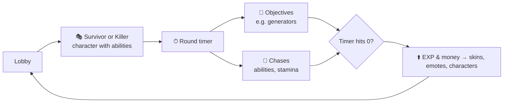

# 🩸 Forsaken

![[forsaken_icon.png|180]]

> [!summary] TL;DR — asymmetric horror with a Roblox-folklore cast
> ✅ "SURVIVORS: Protect your teammates, complete the objectives, and survive until the timer hits 0. KILLERS: Kill them all." A Dead-by-Daylight-style 1-vs-many game whose characters are **Roblox internet legends** (🔎 John Doe, Guest 1337, Shedletsky, Elliot, Chance, Two Time…) drawn in a gritty comic style. ✅ "RIA 2025 Best Survival Experience", still in BETA, **#16 Top Playing** and **#3 Top Trending** with 59,920 players.

> [!note] Confidence legend
> ✅ official Roblox data · 📰 third-party guides · 🔎 official store images · 🧠 design analysis — verify in-game

> [!info] ✅ Live snapshot — Roblox API, 2026-11-12
> | Metric | Value |
> |---|---|
> | Players right now | **59,920** (#16 Top Playing Now) |
> | Top Trending rank | #3 |
> | Total visits | 5,939,423,804 (5.94B) |
> | Favorites | 3,302,440 |
> | Like ratio | 84.4% |
> | Server size (max players) | 9 |
> | Created | 2024-07-28 |
> | Last updated | 2026-11-12 |
> | Genre (Roblox taxonomy) | Survival › 1 vs All |
> | Developer | Forsaken Dev Team (Group) |
> | Game passes for sale | 4 |
> | Store page | [roblox.com/games/18687417158](https://www.roblox.com/games/18687417158) |

## 1. Core loop

## 2. Gameplay mechanics

- ✅ Survive-the-timer objective; ✅ ~9-player servers (1 killer vs survivors).
- 🧠 **Characters with kits** (abilities, cooldowns) — hero-shooter appeal inside a horror game; mastering one character = identity.
- ✅ Progression via **EXP** (V.I.P pass: +25% EXP "for all characters") — per-character levels implied.
- ✅ **Emotes are content** (Emote Packs, 2x Emotes pass "unlocks eight additional emote slots").
- ✅ Content warning in the description ("CONTAINS FLASHING LIGHTS AND LOUD AUDIO") — accessibility honesty.

## 3. HUD

![[hud-forsaken.jpg]]

| # | Element | Notes | Conf. |
|--:|---|---|:--:|
| 1 | **Round timer** — 'survive until 0' | The win condition is the clock. | ✅ |
| 2 | **Team portraits + HP** | Who's down, who needs help. | 🧠 |
| 3 | **Health + stamina** | Chase economy. | 🧠 |
| 4 | **Ability buttons with cooldowns** | Per-character kits. | 🧠 |
| 5 | **Objective counter** | Shared team goal. | 🧠 |
| 6 | **Red edge pulse** | Proximity threat as screen effect + audio. | 🧠 |

## 4. Art style

> [!gallery]- 🔎 Official store images (9) — click to expand
> ![[forsaken_thumb-1.jpg]] ![[forsaken_thumb-2.jpg]] ![[forsaken_thumb-3.jpg]] ![[forsaken_thumb-4.jpg]] ![[forsaken_thumb-5.jpg]] ![[forsaken_thumb-6.jpg]] ![[forsaken_thumb-7.jpg]] ![[forsaken_thumb-8.jpg]] ![[forsaken_thumb-9.jpg]]

- 🔎 **Painted, comic/horror key art** — heavy reds and violets on near-black (`#0B050A` = 29%), scratchy brush texture, a character-select grid image. 🧠 The roster *is* the marketing: each character is a fan-art subject.
- 🔎 Distressed gothic logo type with a slash through the "R".

🎨 **Measured palette** (store images, share of pixels):  `#0B050A` 29.1%  `#550C0E` 8.0%  `#462C28` 8.0%  `#1A1046` 6.4%  `#6C4C43` 5.3%  `#911915` 5.1%  `#3D28A2` 3.7%

## 5. Shop, game passes & monetization

| Icon | Pass | Price | What it gives (official description) |
|:--:|---|--:|---|
| ![[forsaken_pass-1956440532.png\|56]] | **Emote Pack #3** | R$ 189 | Includes: - 5 brand new emotes! Icon - Jameskruel Emotes - z_papermoon, daivians, AlexIsFunny, jamindaminn |
| ![[forsaken_pass-1167749181.png\|56]] | **2x Emotes** | R$ 199 | Hit more dance moves till you're damned! • Unlocks eight additional emote slots to fit in all your emotes. • Dance with more of your purchased emotes so none are left… |
| ![[forsaken_pass-1724751585.png\|56]] | **Skin Pack #4** | R$ 349 | Includes 5 new skins: - MLG John Doe - MLG Dusekkar - MLG Guest 1337 - MLG Helperbot - MLG Jane Doe |
| ![[forsaken_pass-1009460688.png\|56]] | **V.I.P** | R$ 599 | Welcome to the cool kid's table! • Gives you 25% more EXP permanently for all characters (stacks with boosts) • Gives you a permanent [VIP] title (togglable in the… |

_Plus 7 retired / off-sale passes (limited-time items, old bundles) — see [[Game Pass Database]]._

- ✅ Skins and emotes in numbered packs (#3, #4…) — a predictable drop cadence.
- ✅ Retired passes include a **charity Earth Day pass** and a **collab killer** (Cameraman) — community goodwill + crossover hype.

## 6. Why it performs

1. **Asymmetric tension** — every round has a villain.
2. **Nostalgia cast** of Roblox folklore.
3. **Character mastery** gives long-term identity.
4. **Fandom-friendly art** (comic style, roster).

## 7. Steal this

> [!tip] Copy these
> - Build a **roster** with distinct silhouettes and kits.
> - Use **audio + screen edges** as the threat HUD.
> - Ship cosmetics as **numbered packs** on a cadence.

## Sources
- ✅ Roblox API 2026-11-12. Full list: [[Sources]]
