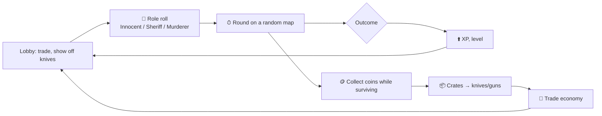

# 🔪 Murder Mystery 2

![[murder-mystery-2_icon.png|180]]

> [!summary] TL;DR — twelve years old and still top-5
> Social deduction in 3-minute rounds: ✅ **Innocents** hide and expose, the **Sheriff** has the only gun, the **Murderer** must eliminate everyone. Between rounds you **collect and trade hundreds of knives** (✅). Made by a single creator (✅ Nikilis, user account), created 2014-01-18, **#5** today with 201,273 players. Its monetization is a masterclass in **limited-time scarcity**: 70 retired passes, most of them "available for a LIMITED TIME" godly knife bundles.

> [!note] Confidence legend
> ✅ official Roblox data · 📰 third-party guides · 🔎 official store images · 🧠 design analysis — verify in-game

> [!info] ✅ Live snapshot — Roblox API, 2026-11-12
> | Metric | Value |
> |---|---|
> | Players right now | **201,273** (#5 Top Playing Now) |
> | Top Trending rank | — |
> | Total visits | 32,232,251,220 (32.23B) |
> | Favorites | 24,819,166 |
> | Like ratio | 90.8% |
> | Server size (max players) | 12 |
> | Created | 2014-01-18 |
> | Last updated | 2026-11-06 |
> | Genre (Roblox taxonomy) | Survival › 1 vs All |
> | Developer | Nikilis (User) |
> | Game passes for sale | 3 |
> | Store page | [roblox.com/games/142823291](https://www.roblox.com/games/142823291) |

## 1. Core loop

## 2. Gameplay mechanics

- ✅ Three asymmetric roles; 🧠 the random role is the hook — every round is a different game.
- ✅ Coin collection during rounds with a **bag limit** (Elite pass "raises coin bag limit to 50").
- ✅ Knives & guns as collectibles and a **trading economy** ("Collect and trade hundreds of knives!").
- ✅ **Evolving knives** ("EVO" passes: "This knife EVOLVES as you use it! It starts as a RARE…").

## 3. HUD

![[hud-murder-mystery-2.jpg]]

| # | Element | Notes | Conf. |
|--:|---|---|:--:|
| 1 | **Role reveal splash** | Huge type, role colour (Sheriff blue / Murderer red / Innocent green). | 🧠 |
| 2 | **Round timer + map name** | Top-center. | 🧠 |
| 3 | **Coin bag counter** | 23/40 (Elite raises the cap to 50). | ✅ |
| 4 | **Radio button, bottom-left** | ✅ The pass text: "press the Radio button in the bottom left corner". | ✅ |
| 5 | **Single weapon slot** | Only the role's tool. | 🧠 |
| 6 | **No role labels on other players** | Hidden information is the gameplay. | 🧠 |

## 4. Art style

> [!gallery]- 🔎 Official store images (3) — click to expand
> ![[murder-mystery-2_thumb-1.jpg]] ![[murder-mystery-2_thumb-2.jpg]] ![[murder-mystery-2_thumb-3.jpg]]

- 🔎 Black backgrounds, a sharp knife-shaped "2" logo, classic blocky characters; maps are simple, slightly spooky low-poly houses and mansions. 🧠 Simplicity = runs on any device, which mattered in 2014 and still matters on cheap phones.

🎨 **Measured palette** (store images, share of pixels):  `#000000` 22.0%  `#191C1D` 15.2%  `#42332C` 9.1%  `#5E473E` 8.4%  `#D1B379` 4.3%  `#81735F` 4.1%  `#D77D2B` 3.5%

## 5. Shop, game passes & monetization

| Icon | Pass | Price | What it gives (official description) |
|:--:|---|--:|---|
| ![[murder-mystery-2_pass-1308795.png\|56]] | **Radio** | R$ 475 | Play music out loud for your friends (or random strangers)! To use it, press the Radio button in the bottom left corner. WARNING: Copyrighted music is not allowed on… |
| ![[murder-mystery-2_pass-429957.png\|56]] | **Elite** | R$ 499 | + 1.5 XP rates + Elite name tag + Elite exclusive knife + Coin bag limit raised to 50 + Elite Radio skin + Elite Effect + Elite Pet . |
| ![[murder-mystery-2_pass-2036403000.png\|56]] | **BUNDLE: Mortal** | R$ 3,399 | === Available for a LIMITED TIME! === + Exclusive GODLY knife! + Exclusive GODLY effect! + Exclusive GODLY gun! [ WARNING: Do not delete the game-pass. You can… |

_Plus 70 retired / off-sale passes (limited-time items, old bundles) — see [[Game Pass Database]]._

- ✅ **70 retired passes**: monthly "GODLY of the Month", seasonal bundles (Beach, Snowstorm, Sakura, Halloween…), item packs. Each says "Available for a LIMITED TIME". 🧠 Scarcity + a trading economy = items keep (and gain) value, so buying feels like investing.
- ✅ Evergreen passes: **Radio 475**, **Elite 499** (+1.5 XP, tag, knife, bigger coin bag, effects).

## 6. Why it performs

1. **Social deduction** generates drama and laughter (great for streaming).
2. **Short rounds**, instant variety via roles.
3. **Collect & trade** economy with real scarcity.
4. **Low-spec art** that runs everywhere.

## 7. Steal this

> [!tip] Copy these
> - **Random roles** = replayability for free.
> - **Limited-time cosmetics + trading** = an economy with memory.
> - Put the **identity reveal** in the biggest type on screen.

## Sources
- ✅ Roblox API 2026-11-12. Full list: [[Sources]]
