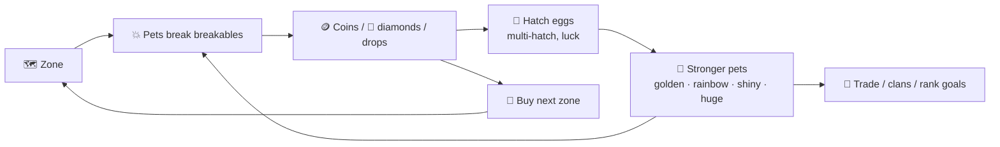

# 🐾 Pet Simulator 99

![[pet-simulator-99_icon.png|180]]

> [!summary] TL;DR — the reference implementation of the pet-collection simulator
> BIG Games' flagship: ✅ "Create an army of the coolest pets! They will help you get RICH!" with ✅ **3,000+ pets**. Pets swarm breakables (coins, chests) in zone after zone; you hatch eggs with ever more luck, rank up, trade huges. **94.7% like ratio** (the highest of the core 12) and **13 passes** that are almost all **automation and luck**. Now **#20** with 51,864 players under a '[MINIGAMES]' update tag.

> [!note] Confidence legend
> ✅ official Roblox data · 📰 third-party guides · 🔎 official store images · 🧠 design analysis — verify in-game

> [!info] ✅ Live snapshot — Roblox API, 2026-11-12
> | Metric | Value |
> |---|---|
> | Players right now | **51,864** (#20 Top Playing Now) |
> | Top Trending rank | — |
> | Total visits | 2,708,595,723 (2.71B) |
> | Favorites | 2,225,017 |
> | Like ratio | 94.7% |
> | Server size (max players) | 10 |
> | Created | 2022-02-05 |
> | Last updated | 2026-11-12 |
> | Genre (Roblox taxonomy) | Simulation › Incremental Simulator |
> | Developer | BIG Games Pets (Group) |
> | Game passes for sale | 13 |
> | Store page | [roblox.com/games/8737899170](https://www.roblox.com/games/8737899170) |

## 1. Core loop

## 2. Gameplay mechanics

- ✅ **Pet variants** stack: base → Golden → Rainbow (Magic Eggs pass), **Shiny** (Super Shiny Hunter pass), **Huge** (Huge Hunter pass).
- ✅ **Multi-hatch** (+15 Eggs pass) and **more equipped pets** (+15 Pets pass) — numbers that scale the spectacle.
- ✅ **Automation**: Auto Farm (pets stay in areas), Auto Tap, Daycare slots.
- ✅ **Rank goals with stars** (Double Stars pass) — a structured quest track.
- 🧠 Zone gates bought with currency = the map is the progression bar.

## 3. HUD

![[hud-pet-simulator-99.jpg]]

| # | Element | Notes | Conf. |
|--:|---|---|:--:|
| 1 | **Currency stack** (diamonds, coins) | Premium currency on top. | 🧠 |
| 2 | **Button grid** — pets, items, shop, rewards, teleport, settings | Notification badges drive clicks. | 🧠 |
| 3 | **Breakable with HP bar** + pet swarm + coin popups | The screen is *full* of feedback — the spectacle is the point. | 🧠 |
| 4 | **Rank progress** with star goals | Always-on quest. | ✅/🧠 |
| 5 | **Boost timers** | Potions/boosts visible = their value is visible. | 🧠 |
| 6 | **Hatch ×8** | Multi-hatch as a primary action. | ✅ |

## 4. Art style

> [!gallery]- 🔎 Official store images (4) — click to expand
> ![[pet-simulator-99_thumb-1.jpg]] ![[pet-simulator-99_thumb-2.jpg]] ![[pet-simulator-99_thumb-3.jpg]] ![[pet-simulator-99_thumb-4.jpg]]

- 🔎 **Cube-bodied pets with big expressive eyes** — a single body template scaled to 3,000+ pets via colour, ears, accessories and effects. 🧠 The most production-efficient pet style on the platform.
- 🔎 Neon outline icons (pumpkin, bat, moon, crown) as event 'tags' around the hero pet.

🎨 **Measured palette** (store images, share of pixels):  `#1C1317` 11.9%  `#E6E8E9` 10.7%  `#DB810B` 10.2%  `#12C1FB` 8.7%  `#5C181B` 8.6%  `#97062E` 8.3%  `#8287A5` 7.9%

## 5. Shop, game passes & monetization

| Icon | Pass | Price | What it gives (official description) |
|:--:|---|--:|---|
| ![[pet-simulator-99_pass-265320491.png\|56]] | **Auto Farm! ♻️** | R$ 175 | Pets stay in areas on command! |
| ![[pet-simulator-99_pass-205379487.png\|56]] | **Lucky! 🍀** | R$ 275 | Boost your luck with all eggs by +200%! (PERMANENT, STACKS) |
| ![[pet-simulator-99_pass-265324265.png\|56]] | **Auto Tap! ☝️** | R$ 350 | Automatically tap breakables! |
| ![[pet-simulator-99_pass-259437976.png\|56]] | **+15 Pets! 🐾** | R$ 375 | Get a headstart with +15 pets equipped! [STACKS] |
| ![[pet-simulator-99_pass-257811346.png\|56]] | **VIP! ⭐** | R$ 400 | Benefits include: - VIP mine! - Exclusive Axolotl Hoverboard! - Exclusive VIP Booth! - Gifts every 6 hours! - Chat nametag! - 10k Diamonds! |
| ![[pet-simulator-99_pass-655859720.png\|56]] | **+15 Eggs! 🥚** | R$ 625 | Get a headstart with +15 egg open! [STACKS] |
| ![[pet-simulator-99_pass-651611000.png\|56]] | **Daycare Slots! 💖** | R$ 625 | Send more pets to daycare, for even more rewards! |
| ![[pet-simulator-99_pass-257803774.png\|56]] | **Ultra Lucky! 🍀✨** | R$ 800 | Hatch even rarer pets with +500% luck on all eggs! (PERMANENT, STACKS) |
| ![[pet-simulator-99_pass-258567677.png\|56]] | **Magic Eggs! ✨** | R$ 1,200 | Bonus chance hatching Golden and Rainbow pets from any egg! |
| ![[pet-simulator-99_pass-975558264.png\|56]] | **Super Shiny Hunter!** | R$ 1,600 | Significantly boosts your chance to hatch shiny pets! (PERMANENT, STACKS) |
| ![[pet-simulator-99_pass-690997523.png\|56]] | **Super Drops! ⭐** | R$ 2,400 | Random drops from breakables are even better! |
| ![[pet-simulator-99_pass-720275150.png\|56]] | **Double Stars! ⭐** | R$ 2,400 | Get double stars for completing rank goals! |
| ![[pet-simulator-99_pass-264808140.png\|56]] | **Huge Hunter! 🔥** | R$ 3,250 | Significantly more luck hatching active Huge Pets! [NO REBIRTH REQUIRED] |

_Plus 1 retired / off-sale passes (limited-time items, old bundles) — see [[Game Pass Database]]._

- ✅ **Luck stacks**: Lucky 275 (+200%), Ultra Lucky 800 (+500%) — "PERMANENT, STACKS".
- ✅ **High-end hunters**: Huge Hunter 3,250, Super Shiny Hunter 1,600, Super Drops 2,400, Double Stars 2,400 — 🧠 priced for veterans with deep investment.
- 🧠 Passes sell *time* (automation) and *odds* (luck) — never direct pets — which keeps the trading economy meaningful.

## 6. Why it performs

1. **Proven formula** refined over a series (PS1 → PSX → PS99).
2. **Massive collection** (3,000+).
3. **Trading & huges** as long-term goals.
4. **Constant events/minigames** (current '[MINIGAMES]' tag).

## 7. Steal this

> [!tip] Copy these
> - One **pet body template**, thousands of variants.
> - Sell **automation and odds**, not the collectible itself.
> - Mark stacking passes **(PERMANENT, STACKS)** in the name/description.

## Sources
- ✅ Roblox API 2026-11-12. Full list: [[Sources]]
