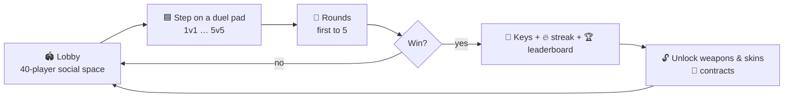

# 🎯 RIVALS

![[rivals_icon.png|180]]

> [!summary] TL;DR — the shooter that broke Roblox's 'shooters don't top the charts' rule
> RIVALS (Nosniy Games) is a **round-based duel FPS**: step on a duel pad in the lobby, fight 1v1 up to 5v5, **first to 5 rounds wins**. No grind for power — **keys unlock weapons and skins**, contracts give exclusive rewards, win streaks and leaderboards give status. **97.32M favorites** (the most of any game in this vault), **19.27B visits**, **93.6% like ratio**, on PC, phone, tablet, Xbox and PS5, and ✅ "RIA25 Best Shooter Experience / RIA26 Best Shooter Experience" in its description.

> [!note] Confidence legend
> ✅ official Roblox data · 📰 third-party guides · 🔎 official store images · 🧠 design analysis — verify in-game

> [!info] ✅ Live snapshot — Roblox API, 2026-11-12
> | Metric | Value |
> |---|---|
> | Players right now | **120,246** (#7 Top Playing Now) |
> | Top Trending rank | — |
> | Total visits | 19,274,501,437 (19.27B) |
> | Favorites | 97,317,761 |
> | Like ratio | 93.6% |
> | Server size (max players) | 40 |
> | Created | 2024-05-26 |
> | Last updated | 2026-11-09 |
> | Genre (Roblox taxonomy) | Shooter › Deathmatch Shooter |
> | Developer | Nosniy Games (Group) |
> | Game passes for sale | 8 |
> | Store page | [roblox.com/games/17625359962](https://www.roblox.com/games/17625359962) |

---

## 1. Core loop

✅ Store description: "Challenge someone by stepping on a duel pad! · Earn keys to unlock new weapons & skins! · Complete contracts to unlock exclusive rewards! · Show off your win streak and climb the leaderboards!"

## 2. Gameplay mechanics

- **Duel pads** (✅): matchmaking is a *physical place* in the lobby. You can challenge the person standing next to you — friends, rivals, streamers. 🧠 This turns the lobby into a social stage and makes 'I'll 1v1 you' a one-step action.
- **Round format** (✅ first to 5): short, repeatable, comeback-friendly. 📰 one life per round, map vote before team duels, larger maps required at 3v3+.
- **Loadout of four slots** (📰 primary / secondary / melee / utility) — 🧠 four is the most a phone player can map comfortably.
- **Fair progression** (📰 guides say purchases are cosmetic or unlock weapons also earnable with keys). ✅ The "Standard Weapons Bundle" pass even refunds keys already spent on standard weapons — goodwill pricing.
- **Anti-cheat stance in the description** (✅ "Cheaters will be permanently banned with no second chances") — 🧠 competitive games must *signal* fairness up front.
- **Seasons & events** (✅ "UPDATE 24 – HAPPY RIVALSWEEN!"; 📰 Season Pass with free + paid tracks, contracts).

## 3. HUD

![[hud-rivals.jpg]]

| # | Element | Notes | Conf. |
|--:|---|---|:--:|
| 1 | **Score + round + timer, top-center** | Pips show 'first to 5' at a glance. | ✅/🧠 |
| 2 | **Names + win streak** | Streak is the status flex the description promotes. | ✅/🧠 |
| 3 | **Kill feed, top-right** | Short, colour-coded by team, special tags (headshot). | 🧠 |
| 4 | **Crosshair + hit marker + damage number** | The core feedback loop of any shooter. | 🧠 |
| 5 | **Health bar, bottom-center** | Single bar, numeric value. | 🧠 |
| 6 | **Loadout 1–4** | Primary / secondary / melee / utility. | 📰 |
| 7 | **Ammo + weapon name** | Big numerals, condensed sans (Gotham/Montserrat style). | 🧠 |
| 8 | **Touch fire / aim zones** | Console + mobile parity needs dedicated touch layout. | ✅ platforms / 🧠 |

🧠 **Information density is low** compared with simulators: no currency on screen mid-round, no menu buttons. Competitive HUDs remove everything that isn't the fight. → [[HUD Design#Archetype B — competitive FPS]]

## 4. GUI & menus

- 🧠 Lobby-first UI: shop, inventory, contracts and season pass live in the lobby, never in the round.
- 📰 Codes are redeemed via Shop → More → Codes (codes are case-sensitive).
- 🧠 Cosmetic shops in shooters must show the item **in first person** (weapon inspect) — that's what the player will actually look at.

## 5. Intuitiveness — 🧠 score 4.4 / 5

| Criterion | Score | Why |
|---|:--:|---|
| First 60 s clarity | 5 | Pads are self-explanatory; FPS controls are universal. |
| Verb count | 4 | Move, aim, shoot, swap, reload — more than a simulator. |
| Phone readability | 4 | Red-on-pale contrast helps; touch aiming is inherently harder. |
| Feedback | 5 | Hit markers, tracers, round banners. |
| Menu depth | 4 | Contracts, wraps, charms, finishers… deep cosmetic taxonomy. |

## 6. Art style

> [!gallery]- 🔎 Official store images (10) — click to expand
> ![[rivals_thumb-1.jpg]] ![[rivals_thumb-2.jpg]] ![[rivals_thumb-3.jpg]] ![[rivals_thumb-4.jpg]] ![[rivals_thumb-5.jpg]] ![[rivals_thumb-6.jpg]] ![[rivals_thumb-7.jpg]] ![[rivals_thumb-8.jpg]] ![[rivals_thumb-9.jpg]] ![[rivals_thumb-10.jpg]]

![[anno-rivals-contrast.jpg]]

- 🔎 **Faceless pure-red figures** on **white/lavender tiled arenas** — measured at ~14% `#FA0204` red against ~38% pale lavender/white. 🧠 The brand image *is* the readability rule: targets pop against the arena.
- 🔎 **Toy-like chunky weapons** with saturated accents (orange, lime) — cosmetics read clearly in first person.
- 🔎 **Glow tracers and hit flares** — the spectacle is the feedback, not explosions.

🎨 **Measured palette** (store images, share of pixels):  `#EAEBF6` 16.2%  `#FA0204` 14.2%  `#C6CBE9` 11.8%  `#101614` 10.7%  `#A0AADB` 9.8%  `#8080BE` 9.7%  `#5A37AF` 6.3%

## 7. Map & world

- 📰 Dozens of compact arenas (one source lists 15 regular, 7 'big' variants, 7 legacy and rotating experimental maps). 🧠 Duel maps are small, symmetric and lane-based so rounds stay short.
- ✅ **40-player servers** host the *lobby*; matches are small (1v1–5v5) inside it. 🧠 A full lobby = a crowd to show off in front of.

## 8. Models, assets & cosmetics

- ✅ Pass names reveal the cosmetic taxonomy: **weapons, skins, charms** (e.g. "Exclusive Explosion Charm for all weapons"), emoji charms, bundles. 📰 Plus wraps, finishers, emotes, Skin Cases.
- 🧠 **Charms are cross-weapon** cosmetics — one purchase shows up on everything you use.

## 9. Animations & game feel

- 🧠 Weapon inspect, finishers and emotes are the 'pet hatch' of shooters: moments to show off. Recoil, tracers, hit-stop and kill confirmation sounds make the loop feel fair and crunchy.

## 10. Fonts & typography

- 🧠 Competitive HUD type: geometric sans (GothamBlack → Montserrat on Roblox), tight tracking, numerals first. No outlines needed when the HUD sits on dark translucent plates. ![[gui-font-specimens.png]]

## 11. Shop, game passes & monetization

| Icon | Pass | Price | What it gives (official description) |
|:--:|---|--:|---|
| ![[rivals_pass-839491390.png\|56]] | **Starter Bundle!** | R$ 59 | Gives the following: • x1 Standard Weapon Crate! • Shorty! • Exclusive Too Shorty Skin for the Shorty! • Exclusive Emoji: Nauseated Charm for all weapons! • Exclusive… |
| ![[rivals_pass-1162134376.png\|56]] | **RPG Bundle!** | R$ 95 | Gives the following: • RPG! • Exclusive Pencil Launcher Skin for the RPG! • Exclusive Emoji: Nerd Charm for all weapons! • Exclusive Cardboard Wrap for all weapons! •… |
| ![[rivals_pass-837904767.png\|56]] | **Medkit Bundle!** | R$ 289 | Gives the following: • Medkit! • Exclusive Briefcase Skin for the Medkit! • Exclusive First Aid Charm for all weapons! • Exclusive Aurum Wrap for all weapons! •… |
| ![[rivals_pass-838087219.png\|56]] | **Exogun Bundle!** | R$ 649 | Gives the following: • Exogun! • Exclusive Wondergun Skin for the Exogun! • Exclusive Alien Head Charm for all weapons! • Exclusive Nebula Wrap for all weapons! •… |
| ![[rivals_pass-838203071.png\|56]] | **Standard Weapons Bundle!** | R$ 849 | Gives the following: • Every current and future standard weapons! • Key refunds for every standard weapon you've purchased! • Exclusive Mini Disco Ball Charm for all… |
| ![[rivals_pass-838160059.png\|56]] | **Classic Bundle!** | R$ 865 | Gives the following: • Paintball Gun! • Slingshot! • Trowel! • Subspace Tripmine! • Exclusive Mini Ban Hammer Charm for all weapons! • Exclusive Classic Wrap for all… |
| ![[rivals_pass-977061826.png\|56]] | **Energy Bundle!** | R$ 975 | Gives the following: • Energy Rifle! • Energy Pistols! • Exclusive Apex Rifle Skin for the Energy Rifle! • Exclusive Apex Pistols Skin for the Energy Pistols! •… |
| ![[rivals_pass-838198043.png\|56]] | **Heavy Duty Bundle!** | R$ 1,425 | Gives the following: • Grenade Launcher! • Minigun! • Flamethrower! • Exclusive Explosion Charm for all weapons! • Exclusive Magma Wrap for all weapons! • Exclusive… |

_Plus 1 retired / off-sale passes (limited-time items, old bundles) — see [[Game Pass Database]]._

- ✅ **A complete price ladder from R$ 59 to R$ 1,425** — entry (Starter 59, RPG 95), mid (Medkit 289, Exogun 649), high (Standard Weapons 849, Classic 865, Energy 975, Heavy Duty 1,425). 🧠 The R$ 59 starter is a *first-purchase converter*; once a player has paid once, the next purchase is far more likely.
- ✅ Every bundle pairs a **weapon + exclusive skin + exclusive charm** — the charm is the cross-sell (shows on every weapon).
- 📰 Skin Cases (~R$ 249) and a Season Pass carry recurring revenue.

## 12. Why it performs

1. **Session shape fits Roblox** — 1–3 minute duels, instant re-queue.
2. **Social matchmaking** — the duel pad turns the lobby into a stage.
3. **Fairness** — skill wins; purchases are mostly cosmetic or earnable.
4. **Cross-platform incl. console** (✅ Xbox & PS5).
5. **Status systems** — streaks, leaderboards, contracts, seasons.
6. **Clear art direction** that makes enemies readable on any device.

## 13. Steal this

> [!tip] Copy these
> - Make matchmaking **diegetic** (pads, portals) so challenges are social.
> - Keep rounds **short** with a 'first to N' format.
> - Build a **price ladder** that starts under R$ 100.
> - Give every bundle a **cross-item cosmetic** (charm/trail/aura).
> - Pick an art direction where **targets contrast with the world**.

## Sources

- ✅ Roblox API, 2026-11-12 (details, votes, thumbnails, passes; RIA award lines are from the official description).
- 📰 [RoWatcher — how RIVALS built its audience](https://rowatcher.com/news/rivals-how-roblox-s-top-shooter-built-a-nearly-million-player-empire) · [Bloxodes game modes](https://bloxodes.com/wiki/rivals/gamemodes) · [GosuGamers Season 3](https://www.gosugamers.net/entertainment/news/78336-roblox-rivals-season-3-launches-with-new-weapons-maps-cosmetics-and-more) · [Pro Game Guides codes](https://progameguides.com/roblox/rivals-codes/)
- Full list: [[Sources]]
