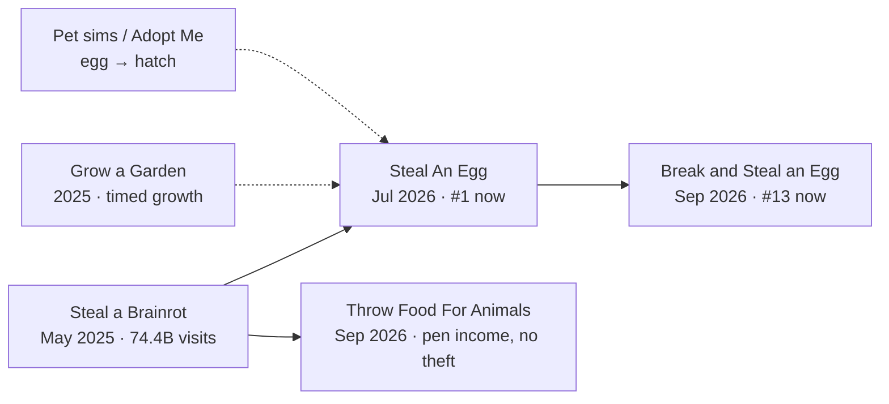

# 📈 Rising Games — November 2026

> [!summary] What's climbing right now and what it tells you
> The trending and up-and-coming charts are where next month's top-10 comes from. Three signals stand out: **the 'Steal a ___' template keeps spawning hits**, **one-verb physics games** (throw, sweep, splash, ragdoll) are surging, and **'meta' monetization** (selling *rules* instead of stats) is appearing. Full chart: [[Live Chart Snapshot 2026-11-12]].

> [!note] Confidence legend
> ✅ official Roblox data · 📰 third-party guides · 🔎 official store images · 🧠 design analysis — verify in-game

## The 'Steal a ___' lineage

| Game | Created | Players | Like % | Key twist | Passes |
|---|---|--:|--:|---|---|
| [[Steal a Brainrot]] | 2025-05-16 | 90,421 | 85.1% | Conveyor + rebirth + theft | 3 |
| [[Steal An Egg]] | 2026-07-25 | 628,983 | 91.4% | + egg hatching + Speed-gated biomes | 2 |
| **Break and Steal an Egg** | 2026-09-05 | 67,531 | 97.0% | ✅ "Break eggs to hatch rare animals · Steal them and escape the guards · Upgrade your speed and pickaxe · Game inspired by steal an egg" | 0 |
| [[Throw Food For Animals]] | 2026-09-18 | 233,220 | 94.4% | Pen income without theft; throw verb | 2 |

![[break-and-steal-an-egg_thumb-1.jpg]]

🧠 **Read**: each iteration keeps the *base + income + rare collectible* skeleton and swaps one verb (buy → steal-from-nests → break-with-pickaxe → throw). Break and Steal an Egg's **97.0%** like ratio shows a clone with one fresh verb can out-rate the original.

## One-verb physics games

### Survive Your Ideas — ✅ 63,134 players, #2 Trending
![[survive-your-ideas_thumb-1.jpg]]
- ✅ "✏️ Type ANY word. It happens. Can you survive? Every round, one random player writes a word… and it COMES TO LIFE! 🌊 Tsunami? 🦖 Dinosaur? ☢️ Nuke? 🌮 Tacos? Anything goes. Words stack up, chaos keeps growing. Last one alive WINS!"
- ✅ **Passes sell rules, not stats**: "2 Words" (279), Meta Words **/chaos** (399), **/god** (499), **/reset** (499), **/admin** (1,449), bundle 1,820 (30% off). 🧠 A new monetization shape: own a *game-changing command* usable once per match.
- 🔎 Thumbnails show a **text box with a SEND button** as the hero UI — the input field *is* the game.

### DONT SPLASH — ✅ 49,433 players
![[dont-splash_thumb-1.jpg]]
- ✅ Horror obby "inspired by the eerie atmosphere of the Poolrooms" (liminal-space aesthetic). 🔎 Tiled pools, a long-limbed water creature, flares and rescue ropes.
- ✅ **Micro-priced upgrade passes**: Rescue Rope 30, each upgrade maxed for 75, extra tool slots 99/149, "All Upgrades Maxed" 149, seasonal packs that expire on a date ("until November 14").

### Sweep The Moon — ✅ 30,198 players, 97.6% likes
![[sweep-the-moon_thumb-1.jpg]]
- ✅ "Inspired by Moon Sweepers on Steam" — 🧠 a Steam indie mechanic ported to Roblox. Start with a toothbrush, sweep dust into a canister, empty for cash, upgrade, automate with robots and belts, co-op up to 4 friends, get the Moon to 100% clean.
- ✅ The best-written pass descriptions in this set ("Infinite Canister — Your back canister never fills, so you can sweep as long as you like. You still empty it at the intake to get paid.") — 🧠 explain exactly what changes and what doesn't.

### The ragdoll wave
- ✅ Same week: *Ragdoll Physics 🩸*, *Bloody Ragdoll Physics 🩸*, *Hyper Realistic Ragdoll*, *Ragdoll Soccer*, *[ATTACHMENTS] Ragdoll Realism*, *[🎩] Ragdoll Research* — all in Trending / Up-and-Coming. 🧠 A micro-trend: physics comedy is cheap to build and clips well on short-form video.

## Other notable risers

| Game | Created | Players | Like % | Why it's interesting |
|---|---|--:|--:|---|
| Cameraman Tower Defense | 2026-08-26 | 46,499 | 98.3% | ✅ "All assets was made by us" — a meme-IP tower defense with the highest like ratio in the set. |
| Dress To Impress | 2023-10-18 | 56,562 | 90.5% | ✅ Fashion runway + voting; passes sell outfit *sets* and makeup tools (VIP 799). Evergreen since 2023. |

![[dress-to-impress_thumb-1.jpg]]

## Takeaways

> [!tip] What to build next (🧠)
> 1. **Fork a proven skeleton, swap one verb** (the 'Steal a ___' lesson).
> 2. **Port a mechanic from Steam indies** (Sweep The Moon ← Moon Sweepers).
> 3. **Sell rules / meta-actions** where it fits (Survive Your Ideas' /god, /chaos).
> 4. **Physics comedy** is the cheapest route to clips — and clips are discovery.

Related: [[Why Games Perform]] · [[Core Loops & Mechanics]]
