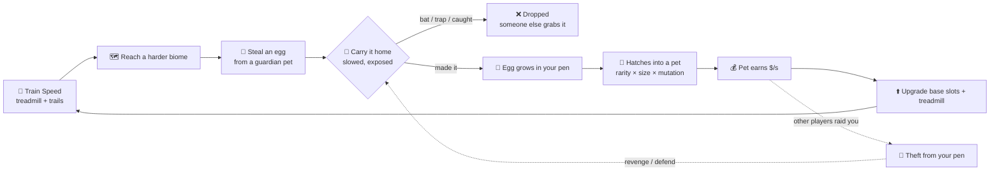

# 🥚 Steal An Egg

![[steal-an-egg_icon.png|180]]

> [!summary] TL;DR — why it's #1 right now
> Steal An Egg fuses **three already-proven Roblox loops** into one: the *steal-from-other-players base tycoon* of [[Steal a Brainrot]], the *egg → hatch → rare pet* loop of [[Adopt Me]] / [[Pet Simulator 99]], and the *train-a-stat-on-a-treadmill* speed simulator. Speed decides which biome you can raid; eggs decide your income; other players decide whether you keep it. Tiny **7-player servers** make every rival visible and every theft personal. It hit **11.06B visits in ~3.5 months** (created 2026-07-25) and holds **#1 on Top Playing Now** with 628,983 players at snapshot.

> [!note] Confidence legend
> ✅ verified from official Roblox data (API / store description / pass text) · 📰 reported by third-party guides (may be outdated) · 🔎 observed in the official store images · 🧠 design analysis or genre convention — verify in-game

> [!info] ✅ Live snapshot — Roblox API, 2026-11-12
> | Metric | Value |
> |---|---|
> | Players right now | **628,983** (#1 Top Playing Now) |
> | Top Trending rank | — |
> | Total visits | 11,064,770,789 (11.06B) |
> | Favorites | 9,749,859 |
> | Like ratio | 91.4% |
> | Server size (max players) | 7 |
> | Created | 2026-07-25 |
> | Last updated | 2026-11-12 |
> | Genre (Roblox taxonomy) | Simulation › Tycoon |
> | Developer | and Collect Rare Pets (Group) |
> | Game passes for sale | 2 |
> | Store page | [roblox.com/games/107778070777162](https://www.roblox.com/games/107778070777162) |

---

## 1. Core loop

✅ The store description spells the loop out in seven emoji lines — itself a lesson (see [[Intuitiveness & Onboarding]]):

> 🥚 Steal eggs from pets · 🐣 Hatch eggs to collect rare pets · 💰 Earn money from your pets · ⬆️ Upgrade your treadmill and base · 🏃 Train on the treadmill to gain Speed · 🥷 Steal eggs from other players · ✨ Discover rarer eggs, pets, sizes, and mutations!

| Loop layer | Length | What drives it |
|---|---|---|
| **Micro** (seconds) | 10–40 s | Run in → grab → sprint home under threat (📰 carrying an egg slows you). |
| **Session** (minutes) | 5–20 min | Egg respawn cycle (📰 ~4.5 min per server), hatch timers, pen income, upgrades. |
| **Meta** (days) | weeks | Biome gates by Speed (📰 ~9 biomes), Index completion, mutations, events (📰 Admin Abuse). |

## 2. Gameplay mechanics

- **Speed is the progression stat** (✅ desc; 📰 guides). You can walk into every biome, but 📰 *stealing* requires the biome's Speed threshold, so Speed works like a soft key. Sources: treadmill (📰 unlocked by upgrading your garden for 1,000) and **trails** from a Trail Shop (📰).
- **Biomes** (📰): Forest (start) → Lake → Desert → Jungle → Snow → … (🔎 desert, grassland, ice and a purple 'space' biome appear in the official thumbnails). Each biome has a themed guardian creature beside its nest (🔎 snake, T-Rex, Yeti, shadow dragon).
- **Egg value = rarity × size × mutation** (✅ desc mentions sizes and mutations). 📰 Heavier eggs hatch into higher-income pets, but size never overrides rarity; 📰 mutations named Silver, Golden, Rainbow, Bloom, Spirit Bloom (Bloom variants via a Sakura Incubator) — multipliers differ between guides, so the *structure* (stacking multipliers) is what to copy, not the numbers.
- **PvP theft** (✅ "Steal eggs from other players"): 📰 a **bat** flings a rival and makes a carrier drop the egg; 📰 **bear traps** hold anyone for 5 s and also force a drop. Theft is *interruptible* — a chase, not an instant loss.
- **Pens hatch over time** (✅ the "X2 GROWTH SPEED! — Eggs grow x2 faster!" pass proves eggs have a grow/hatch timer).
- **Small servers** (✅ max 7 players). 📰 guides recommend **server hopping** to find big eggs because each server rolls its own spawns — the server list becomes part of the game.
- **Cross-platform** (✅ "Supports Desktop, Console, Mobile, and Tablet players").

## 3. HUD

![[hud-steal-an-egg.jpg]]

| # | Element | Notes | Conf. |
|--:|---|---|:--:|
| 1 | **Top-center timers** — egg respawn + event banner | Respawn countdown creates "stay or hop?" decisions; event banner sells the next appointment. | 📰 |
| 2 | **Cash + $/s + Speed** pills, top-left under the Roblox top bar | The two stats in the store description are the two numbers always on screen. Rate (/s) shown separately so growth is felt. | ✅/🧠 |
| 3 | **Left menu: SHOP (green) · INDEX · TRAILS · FREE** | Guides describe Shop and Index pinned to the left; the Shop button is green; passes live in a PASSES section. 2×2 grid stays above the thumbstick zone. | 📰 |
| 4 | **ProximityPrompt "Steal · Yeti Egg"** | Verb + object, hold-to-confirm. Native Roblox component → zero learning cost on every device. | 🧠 |
| 5 | **Egg billboard** — name / rarity / size | Rarity read by colour first (see [[Fonts & Typography]] · [[Pets & Collectibles]]). | ✅/🧠 |
| 6 | **"CARRYING" state banner** + distance home + slowed | The most important state in the game gets the biggest, reddest UI. | 📰/🧠 |
| 7 | **Tools: bat, bear trap** | Few tools, each with one obvious job. | 📰 |
| 8 | **Theft alert** toast | Genre convention in steal-tycoons: pulls you home to defend → PvP happens where the UI points. | 🧠 |

**What to copy:** at most ~6 always-on elements; *state* (carrying, being robbed) gets temporary, loud UI; *menus* stay docked on the left; the center is kept clear for the chase. → [[HUD Design]] · [[Playbook - Build a Mobile-First HUD]]

## 4. GUI & menus

![[gui-shop-window.png]]

- **Shop** (📰): green Shop button → scroll to **PASSES**. The mockup above uses Steal An Egg's real pass icons and prices (✅). 📰 one guide says the shop also sells *one-time timer skips* (developer products) next to the two permanent passes.
- **Index** (📰): the collection book per biome → [[gui-index-window.png|Index anatomy]] in [[GUI & Menus]].
- **Free rewards** (📰): like + favorite + join the group → **10,000 Speed**. A huge early boost exchanged for three discovery signals Roblox's algorithm cares about.

## 5. Intuitiveness — 🧠 score 4.6 / 5

| Criterion | Score | Why |
|---|:--:|---|
| First 60 s clarity | 5 | Store text + biome guardians + 'YOU!' framing; first egg is next to spawn. |
| Verb count | 5 | Run, grab, carry, place. Bat is optional. |
| Phone readability | 4 | Big outlined numbers; risk: billboards stacking in crowded pens. |
| Feedback | 5 | Carry state, theft alerts, income popups, hatch reveal. |
| Menu depth | 4 | Shop/Index/Trails are 1 tap; mutation odds are opaque (guides disagree). |

Rubric: [[Intuitiveness & Onboarding#The 5-point intuitiveness rubric]].

## 6. Art style

> [!gallery]- 🔎 Official store images (4) — click to expand
> ![[steal-an-egg_thumb-1.jpg]] ![[steal-an-egg_thumb-2.jpg]] ![[steal-an-egg_thumb-3.jpg]] ![[steal-an-egg_thumb-4.jpg]]

![[anno-steal-an-egg-chase.jpg]]
![[anno-steal-an-egg-trex.jpg]]

- 🔎 **Creatures** are low-poly / voxel-faceted (blocky T-Rex, faceted snake, voxel Yeti) — fast to produce, readable silhouettes, and they look 'premium' with a glossy render.
- 🔎 **Biome colour-coding**: sand-yellow desert, grass-green meadow, ice-white tundra, neon-purple space grid. One dominant hue per biome = instant 'where am I'.
- 🔎 **The player is always the default 'bacon hair' avatar** with a smug or crying face — the most relatable figure on the platform.
- 🔎 **Sticker treatment**: thick white outline around characters + motion lines + red '!!' and 'YOU!' arrows.

🎨 **Measured palette** (store images, share of pixels):  `#F6C951` 11.5%  `#ECF0F5` 10.4%  `#BF13E6` 10.2%  `#3DC1F9` 9.7%  `#1B2028` 9.1%  `#280A9C` 7.0%  `#D98A1F` 6.5%

→ [[Art Style]] · [[Color Palettes]]

## 7. Map & world

- 🧠 **Hub-and-spoke layout**: player bases/pens around a central area, biomes radiating outward in difficulty order. Distance from base = risk (the carry home is the gameplay).
- 📰 **Biomes as difficulty rings** gated by Speed. Visual gating (you *can* walk in) is friendlier than invisible walls and shows the player what's next.
- ✅ **7-player servers** keep the map readable: you can track every rival. 🧠 Fewer players also means fewer bases to render — good for low-end phones.

→ [[Maps & World Building]]

## 8. Models, assets & pets

- ✅ Pets come in **rarities, sizes and mutations** — three independent multipliers create many sellable variants from one mesh (recolour = mutation, scale = size).
- 📰 Guide counts vary from 78 to 114 pets — content volume is high and growing weekly.
- 🔎 Eggs are as designed as the pets (ornate patterned eggs, a rainbow snowflake egg, a cosmic egg): **the egg is the loot box you can see before you open it**.

→ [[Pets & Collectibles]] · [[Models & Assets]]

## 9. Animations & game feel

- 🔎 Exaggerated hero poses: egg lifted overhead, running crouch, crying when caught — the same energy should be in-game (carry animation, panic run).
- 🧠 Must-haves for this loop: egg-carry animation that *reads* as heavy; knockback on bat hit; hatch reveal (see [[gui-hatch-sequence.jpg|hatch sequence]]); income popups over the pen.

→ [[Animation & Game Feel]] · [[Playbook - Juice & Animation Recipes]]

## 10. Fonts & typography

- 🔎 Thumbnails use a heavy rounded display face with black outline and **rainbow gradient for egg names** ('TREX EGG', 'YETI EGG') and **green outlined money** ('$89,121/s').
- 🧠 That is the Roblox simulator standard: *FredokaOne / LuckiestGuy-style heavy rounded type + UIStroke + UIGradient*. → [[Fonts & Typography]] · ![[gui-font-specimens.png]]

## 11. Shop, game passes & monetization

| Icon | Pass | Price | What it gives (official description) |
|:--:|---|--:|---|
| ![[steal-an-egg_pass-1935039424.png\|56]] | **X2 MONEY!** | R$ 399 | Earn x2 more money! |
| ![[steal-an-egg_pass-1931468161.png\|56]] | **X2 GROWTH SPEED!** | R$ 467 | Eggs grow x2 faster! |

- ✅ **Only two passes**, both permanent multipliers on the two clocks of the game: money (x2) and growth (x2). Prices R$ 399 and R$ 467 — mid-high for passes, justified because they compound for the whole life of the account.
- 📰 One-time **timer skips** and other developer products carry the rest of the revenue (consumables scale with playtime; passes don't).
- 🧠 The 467 price is unusual (not a 99-ending). Odd prices read as 'calculated value' rather than 'sale' — a tactic worth A/B testing.

→ [[Shops & Game Passes]] · [[Game Pass Database]]

## 12. Why it performs

1. **Loop fusion, not invention** — every system is something millions of players already understand (see [[Why Games Perform#Loop fusion]]).
2. **Social conflict with low stakes** — theft is interruptible (bats, traps, chases), so losing an egg is a story, not a rage-quit.
3. **Visible progression** — Speed opens biomes; biomes look different; you *see* where you're going next.
4. **Small servers** — your rivals have names and faces; revenge is personal.
5. **Collect-everything depth** — rarity × size × mutation = thousands of combos from ~100 pets.
6. **Discovery hooks** — like/favorite/group reward, event banners, egg/pet-forward thumbnails.
7. **It's being cloned** — ✅ [[Rising Games Nov 2026|Break and Steal an Egg]] (#13, 97% like) literally says "Game inspired by steal an egg". When the clone wave starts, the format is proven.

## 13. Steal this — actionable takeaways

> [!tip] Copy these
> - Write your store description as **6–8 emoji verb lines** ("🥚 Steal…", "🐣 Hatch…").
> - Pick **one progression stat** that is also a **map key** (Speed → biomes).
> - Make PvP loss **interruptible** (drop on hit, traps, chase) instead of instant.
> - Sell **permanent multipliers on your two core clocks** as passes; sell time-skips as products.
> - Use **3 stacking multipliers** (rarity × size × mutation) to multiply content.
> - Keep servers **small** if theft/rivalry is the hook.

> [!warning] Watch-outs
> - Theft games burn new players if a veteran can strip them in minute one — 🧠 consider new-player shields/locks (see [[Playbook - Steal-a-X Base Loop]]).
> - Opaque mutation odds create guide confusion (📰 guides disagree on multipliers) — publish odds in-game.

## Sources

- ✅ Roblox API: game details, votes, thumbnails, game passes — 2026-07-25 → 2026-11-12.
- 📰 [allthings.how — biomes, speed & pets](https://allthings.how/steal-an-egg-beginner-guide-biomes-speed-and-pets-explained/) · [gamepasses](https://allthings.how/steal-an-egg-how-to-get-gamepasses-in-roblox/) · [bats & bear traps](https://allthings.how/how-to-use-the-bat-and-bear-traps-in-steal-an-egg-roblox/) · [mutations](https://allthings.how/steal-an-egg-mutations-every-multiplier-and-how-to-get-them/) · [admin abuse](https://allthings.how/steal-an-egg-admin-abuse-start-time-and-schedule/) · [games.gg beginner guide](https://games.gg/roblox/guides/steal-an-egg-beginner-guide/) · [Sportskeeda beginner guide](https://www.sportskeeda.com/roblox-news/steal-an-egg-a-beginner-s-guide)
- Full list: [[Sources]]
