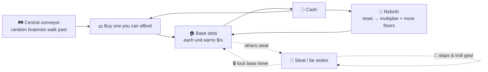

# 🧠 Steal a Brainrot

![[steal-a-brainrot_icon.png|180]]

> [!summary] TL;DR — the template behind the 'Steal a ___' wave
> Buy meme creatures ("brainrots") off a central conveyor, park them in your base where they print money, **steal other players' brainrots** (and lock your base so they can't steal yours), then **rebirth** for permanent multipliers. Created 2025-05-16, it reached **74.44B visits** — the second-most-visited game in this vault after Brookhaven — and 📰 drove Roblox's all-time concurrency record in its August 2025 'admin abuse' war with Grow a Garden. Today it's #9 with 90,421 players: past its peak, still huge, and the direct ancestor of [[Steal An Egg]].

> [!note] Confidence legend
> ✅ official Roblox data · 📰 third-party guides · 🔎 official store images · 🧠 design analysis — verify in-game

> [!info] ✅ Live snapshot — Roblox API, 2026-11-12
> | Metric | Value |
> |---|---|
> | Players right now | **90,421** (#9 Top Playing Now) |
> | Top Trending rank | — |
> | Total visits | 74,444,083,860 (74.44B) |
> | Favorites | 29,734,449 |
> | Like ratio | 85.1% |
> | Server size (max players) | 8 |
> | Created | 2025-05-16 |
> | Last updated | 2026-11-10 |
> | Genre (Roblox taxonomy) | Simulation › Tycoon |
> | Developer | BRAZILIAN SPYDER (Group) |
> | Game passes for sale | 3 |
> | Store page | [roblox.com/games/109983668079237](https://www.roblox.com/games/109983668079237) |

---

## 1. Core loop

✅ Store description: 👽 Buy a Brainrot · 🥷 Steal Brainrots from other players · 💸 Generate money · 🐦‍🔥 Rebirth · ✋ Buy slaps and troll gear to troll other players!

## 2. Gameplay mechanics

- **Conveyor shop** (🔎 store images show a carpeted belt; 📰 guides describe buying from the central belt). 🧠 A *moving* shop creates scarcity and FOMO: the rare one walks past once — buy now or someone else will.
- **Base with floors** (🔎 multi-storey red bases with name signs). 📰 Rebirth unlocks more base capacity and boosts.
- **Theft & defence** (✅ steal; 📰 locks, shields, traps). 🧠 The **base lock timer** is the key UI: a big countdown over your door that everyone in the server can read.
- **Rarity tiers** (📰): Common → Rare → Epic → Legendary → Mythic → Brainrot God → Secret (→ OG in some sources). 📰 ~75 Secrets, ~300+ brainrots.
- **Rebirth** (✅ in description; 📰 resets cash and base, unlocks boosts; 10–17 levels reported).
- **Troll economy** (✅ "Buy slaps and troll gear"): comedic PvP tools instead of weapons.
- **Events** (📰 Admin Abuse sessions; 🔎 Candy and Halloween variants of units).

## 3. HUD

![[hud-steal-a-brainrot.jpg]]

| # | Element | Notes | Conf. |
|--:|---|---|:--:|
| 1 | Cash + **$/s** | 🔎 giant '$997,151,167/s' in the thumbnails shows how much the game sells the rate. | 🔎/🧠 |
| 2 | **SHOP · REBIRTH · INDEX · GEAR** | Rebirth gets a badge when affordable. | 🧠 |
| 3 | **Unit billboard**: name / rarity / $ per second | 🔎 Copied 1:1 in store art. | 🔎 |
| 4 | **Price + 'E Buy' prompt** on conveyor units | Affordability colour (green/red). | 🧠 |
| 5 | **Base lock plate + countdown** | Readable from across the map. | 📰/🧠 |
| 6 | **Event timer** | Appointment play. | 📰 |
| 7 | **Theft alert** | Pulls you home → PvP happens. | 🧠 |
| 8 | **Slap / trap tools** | Comedy PvP. | ✅ |

## 4. GUI & menus

- 🧠 **Rebirth modal** must show *what you lose* vs *what you gain* side by side → ![[gui-rebirth-modal.png]]
- 🧠 **Index** with rarity-coloured frames and silhouettes for unfound units → [[GUI & Menus#Index / collection windows]].

## 5. Intuitiveness — 🧠 score 4.4 / 5

Clear verbs (buy, steal, lock, rebirth); the conveyor teaches the economy by itself. Weak spot: brand-new players can be raided before they understand locks.

## 6. Art style

> [!gallery]- 🔎 Official store images (5) — click to expand
> ![[steal-a-brainrot_thumb-1.jpg]] ![[steal-a-brainrot_thumb-2.jpg]] ![[steal-a-brainrot_thumb-3.jpg]] ![[steal-a-brainrot_thumb-4.jpg]] ![[steal-a-brainrot_thumb-5.jpg]]

![[anno-brainrot-base.jpg]]

- 🔎 **Voxel / brick-built meme characters** (Italian-brainrot internet memes) — the IP is the internet itself, so the audience arrives already knowing the characters.
- 🔎 **Classic Roblox baseplate look**: studded green ground (`#3CCF55` is the top colour), simple red-brick bases, flat sky.
- 🔎 **Variant skins** (Candy pink, Halloween skull) — recolours = cheap new content.

🎨 **Measured palette** (store images, share of pixels):  `#3CCF55` 14.5%  `#F7E9F2` 9.5%  `#233337` 9.0%  `#904E2F` 8.3%  `#AEA08F` 7.3%  `#97F6F8` 7.2%  `#D03030` 6.8%

## 7. Map & world

- 🧠 **Ring of bases around a central conveyor**: every base faces the shop, every player can see every other player's loot. Visibility drives envy → theft → retention.
- ✅ **8-player servers** (max) — same small-server logic as [[Steal An Egg]].

## 8–10. Models, animation, fonts

- 🔎 Units are large and silly with idle animations; 🧠 bounce, wobble and walk cycles carry the humour.
- 🔎 Type: heavy white outlined numbers; **rainbow gradient for SECRET**, seasonal gradients for event variants. → [[Fonts & Typography]]

## 11. Shop, game passes & monetization

| Icon | Pass | Price | What it gives (official description) |
|:--:|---|--:|---|
| ![[steal-a-brainrot_pass-1228591447.png\|56]] | **2x Money** | R$ 299 | — |
| ![[steal-a-brainrot_pass-1229510262.png\|56]] | **VIP** | R$ 375 | — |
| ![[steal-a-brainrot_pass-1227013099.png\|56]] | **Admin Commands** | R$ 7,999 | Type ;cmds in the chat to see a list of commands! |

- ✅ **Admin Commands for R$ 7,999** — the most expensive pass in this whole vault. 🧠 A 'whale' anchor: it makes VIP (375) and 2x Money (299) look cheap, and it sells the fantasy of *being* the admin from the admin-abuse events.
- 🧠 Most revenue in steal-tycoons comes from **developer products** (lucky blocks, instant units, lock extensions) — not visible in pass data.

## 12. Why it performed

1. **Meme IP** that kids already shared on TikTok/YouTube.
2. **Social conflict** baked into the economy.
3. **Rebirth** gives infinite progression from finite content.
4. **Appointment events** — 📰 the admin-abuse war with Grow a Garden pushed Roblox to ~47.3M concurrent users (Aug 23, 2025).
5. **Copyable template** — and it was copied: Steal An Egg, Break and Steal an Egg… → [[Rising Games Nov 2026]]

## 13. Steal this

> [!tip] Copy these
> - A **moving shop** (conveyor) creates scarcity without timers.
> - Make the **defence UI public** (lock countdown above the door).
> - Sell a **whale anchor** pass to frame the rest of the price list.
> - Use **recolour variants** (event skins) as cheap content drops.

## Sources

- ✅ Roblox API 2026-11-12.
- 📰 [GamesRadar — 47.4M concurrent record](https://www.gamesradar.com/games/simulation/roblox-is-reportedly-bigger-than-the-entirety-of-steam-with-a-whopping-47-4-million-concurrent-users-almost-exclusively-thanks-to-two-games-steal-a-brainrot-and-grow-a-garden) · [PocketGamer.biz record](https://www.pocketgamer.biz/robloxs-peak-concurrent-user-count-hits-record-474m-as-steal-a-brainrot-and-grow-a-garden-compete) · [Beebom rebirth guide](https://beebom.com/steal-a-brainrot-rebirth-guide-levels-and-rewards/) · [PocketGamer secrets](https://www.pocketgamer.com/roblox/secret-brainrots-steal-a-brainrot-how-to-unlock) · [Outlook Respawn record report](https://respawn.outlookindia.com/gaming/gaming-news/robloxs-steal-a-brainrot-breaks-all-time-player-record)
