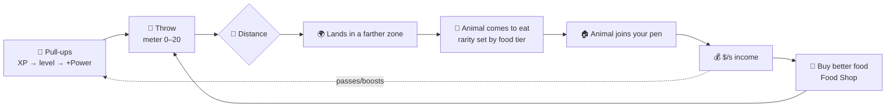

# 🥕 Throw Food For Animals

![[throw-food-for-animals_icon.png|180]]

> [!summary] TL;DR — the fastest riser on Roblox
> One verb — **throw** — tied to the most legible progress bar in games: **distance**. You train Throw Power on pull-up bars, buy better food, hurl it into ever-farther biomes, and the animal that comes to eat it becomes yours and earns money in your pen. Created 2026-09-18, it is **#1 on Top Trending and #4 on Top Playing Now** (233,220 players) with a **94.4% like ratio** — the best-liked game in the top 10. Servers hold only **5 players**.

> [!note] Confidence legend
> ✅ official Roblox data · 📰 third-party guides · 🔎 official store images · 🧠 design analysis — verify in-game

> [!info] ✅ Live snapshot — Roblox API, 2026-11-12
> | Metric | Value |
> |---|---|
> | Players right now | **233,220** (#4 Top Playing Now) |
> | Top Trending rank | #1 |
> | Total visits | 185,089,598 (185.09M) |
> | Favorites | 184,879 |
> | Like ratio | 94.4% |
> | Server size (max players) | 5 |
> | Created | 2026-09-18 |
> | Last updated | 2026-11-12 |
> | Genre (Roblox taxonomy) | Simulation › Tycoon |
> | Developer | Goofy Chupacabra (Group) |
> | Game passes for sale | 2 |
> | Store page | [roblox.com/games/120219252362013](https://www.roblox.com/games/120219252362013) |

---

## 1. Core loop

✅ Store description, verbatim structure: 🥕 Throw food as far as you can · 🦁 Attract and collect animals from different areas · 💰 Earn money from your animals · 🍔 Buy better food to attract rarer animals · 💪 Train on pull-up stands to gain Throw Power · 🌍 Reach new areas with stronger and rarer animals.

Two independent upgrade axes (📰 guides agree):

| Axis | Upgraded by | Controls |
|---|---|---|
| **Throw Power** | pull-up bars → XP → levels (📰 +5 power per level) | *Distance* → which zone the food reaches |
| **Food tier** | Food Shop with cash (📰 carrot free → apple $30 → … up to $1M–$3.2B items) | *Rarity* of the animal that responds |

🧠 Splitting "where" (power) from "what" (food) means a player is never fully stuck: if you can't afford better food, train; if you're maxed on power, farm cash.

## 2. Gameplay mechanics

- **Throw meter 0 → 20** (📰): the closer you release to 20, the farther the throw. A one-button skill check — anyone gets it, mastery still matters.
- **Arc preview + landing ring** (🔎 the official thumbnails draw a thick yellow arc ending in a gold ring on the target zone). 🧠 This is the most important UI in the game: it makes an invisible physics calculation visible and tells you *where the reward will appear*.
- **Zones by distance** (📰 15–17 areas reported: Forest, Savanna, Desert, Jungle, Ocean, Mountains, Taiga, then later Cursed Carnival, Eclipse Kingdom…). 🔎 A store image shows them as **terraced blocks** — grass → meadow → desert → lava → void.
- **Rarity odds as hype** (🔎 '1 IN 999B' in rainbow text over a rainbow gorilla).
- **Animals walk to your pen** after eating (🧠 the walk-back gives a few seconds of "look what I got" that other players in the server also see).
- **Events** (📰 a 2026-11-07 update added a new map and an Admin Abuse event with a Throw Power boost).
- **No code system** (📰) — rewards come from play, not from social-media codes.

## 3. HUD

![[hud-throw-food-for-animals.jpg]]

| # | Element | Notes | Conf. |
|--:|---|---|:--:|
| 1 | **Throw arc + landing ring** (world-space) | The arc is the aim UI. Recolour it by zone/rarity to tease what you'll attract. | 🔎/🧠 |
| 2 | **Throw meter 0–20** with a PERFECT band | Bottom-center, above the hotbar, thumb-reachable. Needle + striped sweet spot. | 📰/🧠 |
| 3 | **Food hotbar** | Food = ammo. Selected slot highlighted; locked foods greyed with price. | 🧠 |
| 4 | **Cash, $/s, Power, level bar** | Power is the stat that matters; level bar shows the next +Power. | 📰/🧠 |
| 5 | **Menu: FOOD · ANIMALS · PASSES · ZONES** | Food Shop is the only food source (📰) so it gets the green, first-position button. | 📰/🧠 |
| 6 | **Animal billboard** — name / rarity / $/s | Same billboard grammar as every top simulator. | 🔎/🧠 |
| 7 | **Zone banner + next-zone requirement**, event strip | Always tells you the next goal in one line. | 📰/🧠 |
| 8 | **"NEW!" catch toast with odds** | Celebrates first-time catches; the odds make it shareable. | 🔎/🧠 |

## 4. GUI & menus

- Shop mockup with the game's real passes: ![[gui-shop-window.png]]
- 🧠 Food Shop should list foods as a **ladder** (cheapest → most expensive) with the next affordable one highlighted — the shop *is* the progression map. See [[GUI & Menus#Shop windows]].

## 5. Intuitiveness — 🧠 score 4.8 / 5

| Criterion | Score | Why |
|---|:--:|---|
| First 60 s clarity | 5 | Free carrot + meter + arc. You understand the game on the first throw. |
| Verb count | 5 | Throw. Pull-up. Buy. |
| Phone readability | 5 | One meter, one button, huge arc. |
| Feedback | 5 | Arc, landing ring, animal run-in, catch toast, money popups. |
| Menu depth | 4 | Zones/food tiers can get long; needs good sorting. |

## 6. Art style

> [!gallery]- 🔎 Official store images (5) — click to expand
> ![[throw-food-for-animals_thumb-1.jpg]] ![[throw-food-for-animals_thumb-2.jpg]] ![[throw-food-for-animals_thumb-3.jpg]] ![[throw-food-for-animals_thumb-4.jpg]] ![[throw-food-for-animals_thumb-5.jpg]]

![[anno-tffa-arc.jpg]]
![[anno-tffa-mystery.jpg]]

- 🔎 **Voxel everything**: animals, foods (voxel carrot, burger, steak, banana) and terrain are built from cubes. 🧠 Voxel = consistent look across hundreds of assets made quickly.
- 🔎 **Classic Roblox checkerboard grass** (bright `#6EEF0B`) and **brown checkered dirt walls** (`#A36633`, the single largest colour) — the nostalgic 'studs' platform look.
- 🔎 **Mystery silhouette with '?'** creates a curiosity gap; **rainbow '1 IN 999B'** turns odds into spectacle.

🎨 **Measured palette** (store images, share of pixels):  `#A36633` 14.4%  `#44AAFC` 14.3%  `#6EEF0B` 11.0%  `#6BC5FB` 10.2%  `#3EC918` 6.8%  `#2488F8` 6.1%  `#EAE0E1` 6.0%

## 7. Map & world

- 🧠 **A linear distance map** — the purest map shape possible: zones are bands at increasing distance from the throw line. Every zone boundary is a milestone you can *see* from the start.
- 🔎 Arena corridors with tall checkered walls frame the throw lane — the camera always looks *down the lane*.
- ✅ **5-player servers**: fewer throwers per lane, less clutter, everyone sees each other's catches.

## 8. Models, assets & pets

- 🔎 Animals scale from everyday (cow, gorilla) to mythic (phoenix, dragons, Fenrir-style wolves reported by guides) — the 'normal → legendary' range sells the long tail.
- 📰 Foods are graded Common → Cosmic; 🧠 the food model itself is a cosmetic reward (a glowing cosmic food looks great mid-air).

## 9. Animations & game feel

- 🧠 Wind-up → release → arc → impact puff → animal sprint-in → eat → follow you home. Each beat is a juice opportunity (see [[Playbook - Juice & Animation Recipes]]).
- 🧠 Pull-ups need a satisfying rep animation + "+XP" popup + level-up burst; they are the grind, so they must feel good.

## 10. Fonts & typography

- 🔎 Heavy rounded display type with dark outline; **rainbow gradient for top rarity and huge numbers** ('PHOENIX $68,543B/S'); green for money. → [[Fonts & Typography]]

## 11. Shop, game passes & monetization

| Icon | Pass | Price | What it gives (official description) |
|:--:|---|--:|---|
| ![[throw-food-for-animals_pass-1998783910.png\|56]] | **x2 Cash** | R$ 99 | Double cash from every animal, forever! |
| ![[throw-food-for-animals_pass-1998987840.png\|56]] | **x2 Training Power** | R$ 149 | Double XP on every pull up, forever! |

- ✅ **Two passes at impulse prices — R$ 99 and R$ 149** — the cheapest permanent multipliers of any top-10 game. 🧠 With a 94%+ like ratio and huge reach, low prices maximise conversion; the expensive progression lives in cash-priced food.
- 🧠 Each pass doubles **one** of the two upgrade axes (cash / training) — same "one pass per clock" pattern as [[Steal An Egg]].

## 12. Why it performs

1. **One-verb clarity** — 'throw food' is the title, the icon, the thumbnail and the first action.
2. **Distance is the most readable progress bar there is.**
3. **Two upgrade axes** (power, food) prevent dead ends.
4. **Tiny servers + visible catches** = social proof without griefing.
5. **Pen income** borrowed from the steal-tycoon wave, minus the theft (no rage).
6. **Cheap passes** and a very high like ratio (algorithm-friendly).

## 13. Steal this

> [!tip] Copy these
> - Build the game around **one physical verb** and **one visible distance**.
> - Show the **trajectory + landing target** before release.
> - Split progression into **"how far" vs "how good"**.
> - Put the **odds** on screen in rainbow text — rarity is content.
> - Start passes at **R$ 99–149** when the audience is young and the game is new.

> [!warning] Watch-outs
> - Linear maps can run out fast; plan zone drops per week (📰 the game already shipped a new map in early November).
> - Low pass prices cap revenue per payer — balance with developer products (boosts, food packs).

## Sources

- ✅ Roblox API (details, votes, thumbnails, passes), 2026-11-12.
- 📰 [Sportskeeda beginner's guide](https://www.sportskeeda.com/roblox-news/throw-food-for-animals-a-beginner-s-guide) · [Pro Game Guides beginner's guide](https://progameguides.com/roblox/complete-throw-food-for-animals-beginners-guide-roblox/) · [games.gg beginner's guide](https://games.gg/roblox/guides/roblox-throw-food-for-animals-beginners-guide/) · [GameRant food list](https://gamerant.com/roblox-throw-food-for-animals-all-food-list-how-to-get/) · [Bloxodes zones & food](https://bloxodes.com/articles/throw-food-for-animals-zones-food-guide) · [Treyex — new map & admin abuse](https://www.treyexgaming.com/?p=19760)
- Full list: [[Sources]]
