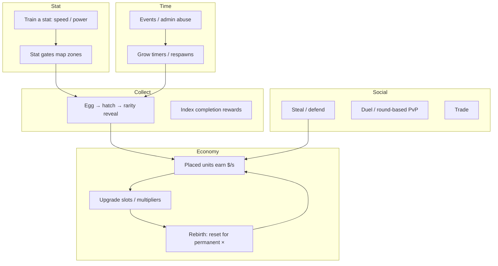

# 🔁 Core Loops & Mechanics

> [!summary]
> Every top game can be described as **one verb + one number that grows + one reason to come back tomorrow**. The best new games don't invent loops — they **fuse two or three proven ones** and change one verb.

## Loop map of the top 12

| Game | Verb (seconds) | Number that grows (minutes) | Reason to return (days) | Social pressure |
|---|---|---|---|---|
| [[Steal An Egg]] | run · steal · carry | $/s, Speed | rarer biomes, mutations, events | theft by 6 rivals |
| [[Throw Food For Animals]] | throw | distance, Throw Power, $/s | new zones, rarer animals | catches visible to 4 others |
| [[RIVALS]] | shoot | win streak, keys | contracts, season pass | duels in a lobby |
| [[Steal a Brainrot]] | buy · steal · lock | $/s, rebirth level | secrets, events | theft |
| [[Brookhaven RP]] | roleplay · drive | — (stories) | friends, new houses | the whole game |
| [[Blox Fruits]] | fight | level (cap 3000), mastery | fruit spawns (hourly), restocks (4 h) | PvP, bounty |
| [[Murder Mystery 2]] | hide · shoot · stab | XP, inventory value | limited knives, trading | deduction |
| [[Adopt Me]] | care | pet age, Bucks | events, neons, trading | trading, families |
| [[99 Nights in the Forest]] | gather · survive | day counter, campfire level | classes, Day 99 | co-op |
| [[Fish It]] | cast · reel | catches, luck | secret fish, events, crews | group fishing |
| [[Pet Simulator 99]] | break · hatch | pets power, rank | huges, events, trading | clans, trading |
| [[Forsaken]] | escape · hunt | character EXP | characters, skins | 1-vs-many |

## Proven loop modules (mix & match)

### Loop fusion examples
- **Steal An Egg** = Collect (egg/hatch) + Economy ($/s pens) + Stat (Speed gates biomes) + Social (steal) + Time (respawns, grow timers).
- **Throw Food For Animals** = Stat (power) + Collect (animals by food tier) + Economy (pen income) — *no theft*.
- **Steal a Brainrot** = Economy + Social (steal) + Rebirth + Time (events).
- **Fish It** = skill check + Collect (rarity × mutation × weight) + Economy (sell).

## Mechanics that keep showing up

| Mechanic | Where | Why it works |
|---|---|---|
| **Rarity × size × mutation** multipliers | Steal An Egg, Fish It, PS99 | Thousands of variants from few assets. → [[Pets & Collectibles]] |
| **Stat-gated zones** | Steal An Egg (Speed), TFFA (Power), PS99 (zone purchase) | The map is the progress bar. → [[Maps & World Building]] |
| **Interruptible PvP loss** | Steal An Egg (bats, traps), Brainrot (locks) | Conflict without rage-quits. |
| **Timed shared spawns** | Blox Fruits (hourly fruits), Steal An Egg (~4.5 min egg resets) | Server-wide treasure hunts. |
| **Rebirth / prestige** | Steal a Brainrot | Infinite progression from finite content. |
| **One-button skill check** | TFFA throw meter, Fish It cast & reel | Skill expression anyone understands. |
| **Diegetic matchmaking** | RIVALS duel pads | Challenges become social. |
| **Random roles** | MM2, Forsaken | Replayability for free. |
| **Care-task bubbles** | Adopt Me | The game writes your to-do list. |
| **Admin-abuse events** | Steal a Brainrot, Steal An Egg, TFFA | Appointment play + clip fuel. |

## How to design your loop (instructions)

1. **Pick one verb** you can show in a thumbnail (throw, steal, sweep, fish).
2. **Attach one growing number** that the HUD shows *with its rate*.
3. **Gate content with that number** (zones, eggs, tiers).
4. **Add one social pressure** (theft, duels, trading, co-op).
5. **Add one clock** (respawns, hatch timers, daily rewards, events).
6. **Fuse a second proven loop** only if it feeds the first (pens feed money → money feeds the verb).
7. **Write the loop as 6–8 emoji lines** for your store description. If you can't, it's too complex.

Use [[Template - Game Teardown]] to analyse competitors the same way.
