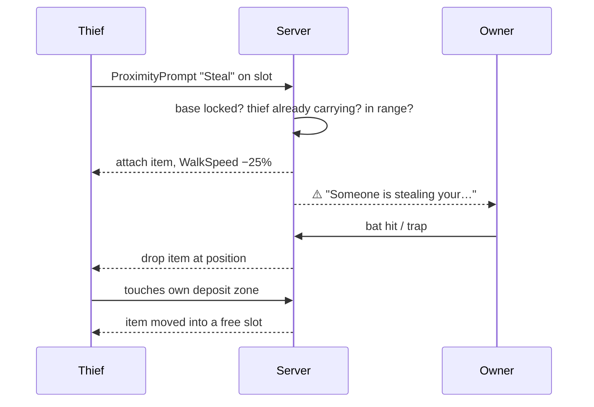

# 🛠️ Playbook — Steal-a-X Base Loop

> [!summary] Goal
> The loop behind [[Steal a Brainrot]] and [[Steal An Egg]]: things in bases earn money; other players can steal them; you can lock your base; carrying is slow and interruptible. **Server-authoritative** throughout. HUD reference: [[hud-steal-an-egg.jpg]] · [[hud-steal-a-brainrot.jpg]]



## Step 1 — Base model & attributes

```text
Bases/Base_1 (Model)        Attributes: OwnerUserId, LockedUntil
├─ Slots/Slot_1..Slot_N     (Part)  Attributes: ItemId
├─ DepositZone               (Part, CanCollide=false, Transparency=1)
├─ LockPlate                 (Part)  → press to lock
└─ Sign (SurfaceGui)         "PlayerName's Base"
```

Assign a free base on `PlayerAdded`; set `OwnerUserId`; write the name on the SurfaceGui sign.

## Step 2 — Stealing & carrying (server)

```lua
-- ServerScriptService/Systems/Stealing.server.lua (core logic)
local Players = game:GetService("Players")

local CARRY_SPEED_MULT = 0.75
local LOCK_SECONDS = 60
local NEW_PLAYER_SHIELD = 300 -- seconds of protection after joining

local function isLocked(base: Model): boolean
	return (base:GetAttribute("LockedUntil") or 0) > workspace:GetServerTimeNow()
end

local function startCarry(player: Player, item: Model)
	local root = player.Character and player.Character:FindFirstChild("HumanoidRootPart")
	local humanoid = player.Character and player.Character:FindFirstChildOfClass("Humanoid")
	if not root or not humanoid or player:GetAttribute("Carrying") then return end

	item:PivotTo(root.CFrame * CFrame.new(0, 3.5, 0)) -- held overhead (as in the thumbnails)
	local weld = Instance.new("WeldConstraint")
	weld.Part0, weld.Part1 = root, item.PrimaryPart
	weld.Name = "CarryWeld"
	weld.Parent = item.PrimaryPart
	for _, part in item:GetDescendants() do
		if part:IsA("BasePart") then
			part.Anchored = false
			part.CanCollide = false
			part.Massless = true
		end
	end
	humanoid.WalkSpeed *= CARRY_SPEED_MULT
	player:SetAttribute("Carrying", item:GetAttribute("ItemId"))
end

local function dropCarry(player: Player, item: Model)
	local weld = item.PrimaryPart:FindFirstChild("CarryWeld")
	if weld then weld:Destroy() end
	item:PivotTo(item:GetPivot() * CFrame.new(0, -3, 0))
	for _, part in item:GetDescendants() do
		if part:IsA("BasePart") then part.Anchored = true end
	end
	local humanoid = player.Character and player.Character:FindFirstChildOfClass("Humanoid")
	if humanoid then humanoid.WalkSpeed /= CARRY_SPEED_MULT end
	player:SetAttribute("Carrying", nil)
	-- re-enable the item's "Steal" prompt so anyone can grab it
end

local function onStealPrompt(player: Player, slot: BasePart, base: Model)
	if base:GetAttribute("OwnerUserId") == player.UserId then return end
	if isLocked(base) then return end
	if not slot:GetAttribute("ItemId") then return end
	-- spawn/move the item model, clear the slot, start the carry
	-- notify the owner:
	local owner = Players:GetPlayerByUserId(base:GetAttribute("OwnerUserId"))
	if owner then
		game.ReplicatedStorage.Remotes.Toast:FireClient(owner, "danger", "Someone is stealing from your base!")
	end
end
```

**Interruptions** (what makes it fun, not frustrating):
- Bat / slap tool hit → `dropCarry` + knock-back (`AssemblyLinearVelocity` impulse on the victim).
- Trap part `Touched` → anchor victim 5 s + `dropCarry` (📰 Steal An Egg bear traps: 5 s).
- Death / leaving → `dropCarry`.

## Step 3 — Locks & new-player shield

```lua
local function lockBase(base: Model, seconds: number)
	base:SetAttribute("LockedUntil", workspace:GetServerTimeNow() + seconds)
end

Players.PlayerAdded:Connect(function(player)
	local base = assignBase(player) -- your function
	lockBase(base, NEW_PLAYER_SHIELD) -- protect beginners
end)
-- LockPlate.Touched → if owner and cooldown ok → lockBase(base, LOCK_SECONDS)
```

Clients render the countdown from `LockedUntil` in a BillboardGui above the door (see [[gui-world-space-kit.png]]).

## Step 4 — Income tick

```lua
-- ServerScriptService/Systems/Income.server.lua
local Players = game:GetService("Players")
local TICK = 1

local function incomePerSecond(player: Player): number
	local total = 0
	for _, slot in getBaseSlots(player) do -- your function
		total += slot:GetAttribute("Income") or 0
	end
	local mult = player:GetAttribute("Pass_X2_MONEY") and 2 or 1
	return total * mult
end

while true do
	task.wait(TICK)
	for _, player in Players:GetPlayers() do
		local rate = incomePerSecond(player)
		player:SetAttribute("Rate", rate) -- HUD shows "+$X/s"
		local cash = player:FindFirstChild("leaderstats") and player.leaderstats:FindFirstChild("Cash")
		if cash then cash.Value += rate * TICK end
	end
end
```

## Step 5 — Balancing checklist

- [ ] A brand-new player can't be robbed for the first ~5 minutes.
- [ ] Carrying is slower than walking but faster than the slowest chaser — chases must be winnable both ways.
- [ ] Theft cap per target per N minutes (prevents griefing one player).
- [ ] Stolen value ≥ the effort (so theft is tempting) but ≤ ~20% of a base (so it never wipes someone).
- [ ] Revenge path: alerts + tracking arrow to the thief.
- [ ] Small servers (✅ 5–8 in the top steal-tycoons).
