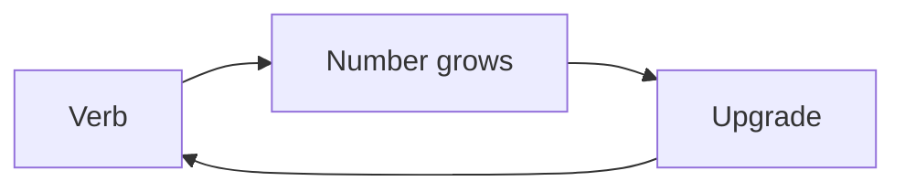

# {{title}}

> [!summary] TL;DR — why it performs (3 sentences)
> 

> [!note] Confidence legend
> ✅ official Roblox data · 📰 third-party guides · 🔎 official store images · 🧠 design analysis — verify in-game

## 1. Core loop
<!-- Copy the store description's How-to-Play lines, then draw the loop. -->

| Loop layer | Length | What drives it |
|---|---|---|
| Micro | | |
| Session | | |
| Meta | | |

## 2. Gameplay mechanics
- 

## 3. HUD
<!-- Screenshot or mockup, then a numbered table. -->

| # | Element | Notes | Conf. |
|--:|---|---|:--:|
| 1 | | | |

## 4. GUI & menus
## 5. Intuitiveness (rubric: [[Intuitiveness & Onboarding#The 5-point intuitiveness rubric]])

| Criterion | Score | Why |
|---|:--:|---|
| First 60 s clarity | | |
| Verb count | | |
| Phone readability | | |
| Feedback | | |
| Menu depth | | |

## 6. Art style
## 7. Map & world
## 8. Models, assets & pets
## 9. Animations & game feel
## 10. Fonts & typography
## 11. Shop, game passes & monetization

| Icon | Pass | Price | What it gives |
|:--:|---|--:|---|
| | | | |

## 12. Why it performs
1. 

## 13. Steal this

> [!tip] Copy these
> - 

> [!warning] Watch-outs
> - 

## Sources
- 
